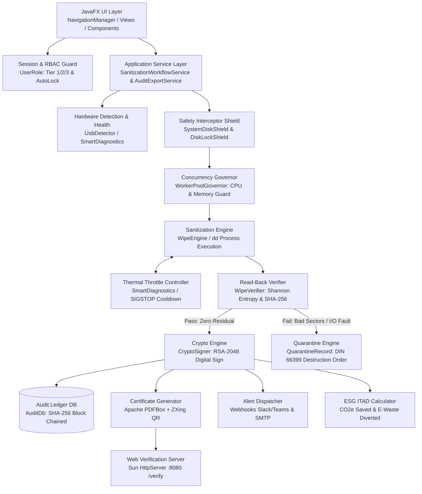

# Secure-Data-Wiping: Enterprise Architecture & Project Study Guide

> **Official Standard Compliance**: NIST SP 800-88 Rev. 1 | DoD 5220.22-M | DoD 5220.22-M ECE | BSI-VS | HMG IS5 | RCMP TSSIT OPS-II | ISO/IEC 27040:2015 | EU GDPR Art. 17 | HIPAA § 164.310 | FISMA / NIST SP 800-53

---

## 1. Executive Summary & Core Purpose

**Secure-Data-Wiping (SecureErase Pro Enterprise)** is a production-grade, defense-standard storage media sanitization and hardware lifecycle assurance suite built in **Java 17** and **JavaFX 21**.

### Primary Mission:
1. **Permanent Physical Data Destruction**: Eliminates data remanence across flash memory (USB thumb drives, NVMe/SATA SSDs) and magnetic disks (HDDs) by writing cryptographic bit-patterns directly to raw block devices (`/dev/rdisk*` on macOS, `/dev/sd*` on Linux, `\\\\.\\PhysicalDrive*` on Windows).
2. **Mathematical Zero-Residual Verification**: Computes real-time **Shannon Entropy** ($H(X)$) across sampled or 100% read-back physical sectors to mathematically attest that zero residual bits survive.
3. **Cryptographic Ledger & Tamper Proofing**: Stores every wipe event in an internal SQLite database linked with **SHA-256 blockchain-style hash chaining** (`prev_record_hash` -> `record_hash`), generating **2048-bit RSA digitally signed PDF compliance certificates** with embedded verification QR codes.
4. **Hardware Failure Quarantine**: Automatically detects failing storage blocks (bad sectors, I/O timeouts), aborts unsafe operations, quarantines the drive, and generates a **DIN 66399 physical destruction work order** (degaussing or shredding).
5. **Real-Time Safety & Hardware Preservation**: Enforces active host OS protection shields (prevents wiping `disk0`, `C:`, or root `/`), hardware thermal throttling with auto-pause (`kill -STOP`/`kill -CONT`), and host CPU concurrency regulation.
6. **ESG / ITAD Carbon Mitigation**: Calculates Scope 3 GHG carbon emissions saved, e-waste diverted in kg, and tree seedling equivalents compared against physical drive shredding.

---

## 2. High-Level System Architecture & Execution Flow



---

## 3. Complete Project Directory Structure & Component Map

```
DWproject/
├── README.md                          # Repository landing overview
├── PROJECT_STUDY_GUIDE.md             # This comprehensive study manual
├── dist/                              # Compiled native installation packages
│   └── USBSanitizer-1.0.0.dmg         # macOS DMG distribution installer
├── packaging/                         # Multi-platform installer build toolchain
│   ├── build-all.sh                   # Master platform detection & packaging router
│   ├── package-mac.sh                 # macOS DMG & App bundle packager (jpackage)
│   ├── package-linux.sh               # Linux RPM / DEB packager
│   ├── package-appimage.sh            # Linux portable AppImage builder
│   ├── package-flatpak.sh             # Linux Flatpak packaging script
│   ├── package-win.bat / .ps1         # Windows MSI / EXE / ZIP packaging scripts
│   ├── IconGenerator.java / IconToIco # Dynamic platform icon converters
│   └── mac/entitlements.plist         # macOS hardened runtime security entitlements
├── .github/workflows/                 # CI/CD automation pipelines
│   ├── ci.yml                         # Automated Maven build, compile, and JUnit 5 tests
│   └── release.yml                    # Multi-platform release artifact generation
└── DataWiping/                        # Core Java Application Maven Module
    ├── pom.xml                        # Maven dependencies & build configurations
    └── src/
        ├── main/resources/            # Application assets, styling, and i18n bundles
        │   ├── css/style.css          # Executive theme design system (~1,670 lines)
        │   ├── icons/icon.png         # High-resolution application brand icon
        │   └── i18n/messages_*.props  # Localized strings: EN, DE, FR, ES, HI
        ├── test/java/com/sanitizer/   # 34 comprehensive JUnit 5 test suites (100% passing)
        └── main/java/com/sanitizer/   # Core source packages (explained in detail below)
```

---

## 4. Package-by-Package Deep Dive ("What is What")

### 4.1. Core Sanitization & Verification Engine (`com.sanitizer.engine`)
* **`WipeEngine.java`**:
  * **Role**: Primary execution orchestrator for low-level block overwriting.
  * **Mechanics**: Manages a fixed thread pool (`Executors.newFixedThreadPool(THREAD_POOL_SIZE)`), forks OS `dd` processes targeting block devices with `bs=2m`, captures standard output progress, computes real-time MB/s, ETA, and 4KB IOPS, and passes telemetry to visualizers.
  * **Control Flow**: Enforces pre-execution validation through `SystemDiskShield`, unmounts partitions via `DiskLockShield`, and invokes `WorkerPoolGovernor` slot acquisition.
  * **Thermal Integration**: Continuously evaluates device temperature against device-specific thermal policies. If critical overheating occurs, dispatches `kill -STOP` (pausing writing), waits for cooldown, and resumes with `kill -CONT`.
* **`WipeVerifier.java`**:
  * **Role**: Post-wipe compliance auditor conforming to NIST SP 800-88 Rev. 1 § 4.7 and ISO/IEC 27040.
  * **Mechanics**: Performs raw block read-back across storage media using three intensity modes: `FAST_SAMPLE_5_PERCENT`, `EXTENSIVE_SAMPLE_10_PERCENT`, or `FULL_100_PERCENT`.
  * **Mathematics**: Calculates **Shannon Entropy** across 256 byte frequency bins:
    $$H(X) = -\sum_{i=0}^{255} p(x_i) \log_2 p(x_i)$$
    A true zero-fill returns an entropy score of $0.0000\text{ bits/byte}$. If any non-zero byte is found ($H(X) > 0.001$), the wipe status fails immediately. Generates a SHA-256 hash digest of the read stream.
* **`WipeMetrics.java`**:
  * **Role**: Immutable record encapsulating instantaneous telemetry: percent complete, current pass, elapsed speed (MB/s), remaining ETA (seconds), temperature (°C), IOPS, latency (ms), and bus saturation percentage (%).
* **`MacUtil.java`**:
  * **Role**: Platform helper for macOS block path normalization (`/dev/diskX` <-> `/dev/rdiskX` raw character device).

---

### 4.2. Defensive Safety Shields & Concurrency (`com.sanitizer.shield`)
* **`SystemDiskShield.java`**:
  * **Role**: Bulletproof multi-OS root and boot disk protection interceptor.
  * **Protection Rules**:
    1. Blocks string signatures: `disk0`, `rdisk0` (macOS), `PhysicalDrive0`, `C:` (Windows), `/dev/sda`, `/dev/nvme0n1` (Linux).
    2. Deep OSHI mount inspection: Inspects live filesystem mounts (`/`, `/boot`, `/System`, `/etc`, `C:\Windows`) and forbids any target matching or sharing physical geometry with an active OS mount.
    3. Triggers immediate alert dispatch via `AlertDispatcher.notifyShieldViolation` if a violation is attempted.
* **`DiskLockShield.java`**:
  * **Role**: Media unmount and locking coordinator.
  * **Mechanics**: Invokes `diskutil unmountDisk` (macOS) or `umount -f` (Linux) to dismount filesystem partitions before low-level block writes, preventing automount daemons (`diskarbitrationd`, `udisks2`) from interrupting the write head.
* **`WorkerPoolGovernor.java`**:
  * **Role**: Host resource regulator.
  * **Mechanics**: Continuously tracks system CPU load ticks and available physical RAM via OSHI. Throttles concurrent disk wipe dispatches if host CPU exceeds $88\%$ load or memory drops below $512\text{ MB}$, preventing system lockups during multi-drive operations.

---

### 4.3. Hardware Detection & Diagnostic Telemetry (`com.sanitizer.detector`)
* **`UsbDetector.java`**:
  * **Role**: Autonomous storage discovery service.
  * **Mechanics**: Uses OSHI (`HardwareAbstractionLayer`) to poll storage devices every 2 seconds on a background daemon. Filters out internal SSDs, system drives, and APFS volumes, isolating removable drives within valid size boundaries (1 GB – 128 GB default). Notifies listeners via JavaFX UI thread or direct invocation.
* **`SmartDiagnostics.java`**:
  * **Role**: S.M.A.R.T. health analyzer and predictive failure evaluator.
  * **Metrics Evaluated**: Reallocated sector count (ID 5), bad blocks, wear leveling percent (ID 173/231), power-on hours (ID 9), temperature (ID 194), UDMA CRC error count (ID 199), and command timeouts (ID 188).
  * **Health Scoring**: Computes a holistic $0-100$ health score and classifies drives into `HEALTHY`, `WARNING`, or `CRITICAL`.
  * **Pre/Post Delta**: Computes `SmartDelta` to attest whether sanitization introduced mechanical stress or wear.
* **`ThermalPolicy.java` & `ThermalPolicyManager.java`**:
  * **Role**: Device-aware thermal thresholds.
  * **Threshold Profiles**:
    * *Magnetic HDD*: Warning $46^\circ\text{C}$, Auto-Pause $52^\circ\text{C}$, Resume $42^\circ\text{C}$.
    * *SATA SSD*: Warning $55^\circ\text{C}$, Auto-Pause $65^\circ\text{C}$, Resume $50^\circ\text{C}$.
    * *NVMe SSD*: Warning $68^\circ\text{C}$, Auto-Pause $78^\circ\text{C}$, Resume $60^\circ\text{C}$.
    * *USB Flash*: Warning $48^\circ\text{C}$, Auto-Pause $58^\circ\text{C}$, Resume $44^\circ\text{C}$.
* **`ThermalThrottleController.java`**:
  * **Role**: Dynamic thermal regulation engine. Evaluates temperature rates and applies pacing delays (sleep milliseconds) to dissipate heat passively before hard pauses are reached.
* **`DeviceType.java`**:
  * **Role**: Enum identifying media physics: `USB_FLASH_DRIVE`, `SATA_SSD`, `NVME_SSD`, `MAGNETIC_HDD`.

---

### 4.4. Sanitization Policy Standards & Profiles (`com.sanitizer.policy`)
* **`WipePolicyManager.java`**:
  * **Role**: Registry and lifecycle manager for international wiping standards and custom user profiles. Supports JSON import/export and disk persistence under `~/.sanitizer/policies`.
* **Built-in Standards**:
  1. **NIST SP 800-88 Rev. 1 Clear**: 1-pass fixed zero-fill (`0x00`).
  2. **US DoD 5220.22-M (NISPOM)**: 3-pass sequence (`0x00` Zero -> `0xFF` One -> Cryptographic Pseudo-Random).
  3. **US DoD 5220.22-M ECE**: 7-pass military wipe (`0x00` -> `0xFF` -> Random -> `0x96` -> `0x00` -> `0xFF` -> Random).
  4. **British HMG Infosec Standard 5 (Enhanced)**: 3-pass sequence (`0x00` -> `0xFF` -> Random).
  5. **German BSI-VS / BSI TL-03423**: 7-pass standard (`0x00` -> `0xFF` -> `0x00` -> `0xFF` -> `0xAA` -> `0x55` -> Random).
  6. **Canadian RCMP TSSIT OPS-II**: 7-pass standard (`0x00` -> `0xFF` -> `0x00` -> `0xFF` -> `0xAA` -> `0x55` -> Random).
* **`WipePolicy.java`**, **`WipePass.java`**, **`WipePatternType.java`**:
  * **Role**: Data structures defining multi-pass patterns (`ZERO_FILL`, `ONE_FILL`, `PSEUDO_RANDOM`, `CUSTOM_BYTE`).

---

### 4.5. Cryptography, Audit Ledger & Attestation (`com.sanitizer.crypto`, `com.sanitizer.db`, `com.sanitizer.audit`)
* **`CryptoSigner.java`**:
  * **Role**: Hardware-grade public-key cryptography engine.
  * **Implementation**: Generates or loads an **RSA 2048-bit keypair** (`sanitizer_private.key` and `sanitizer_public.key`). Signs audit record payloads using **SHA256withRSA**, returning Base64 digital signatures, and verifies signature validity.
* **`AuditDb.java`**:
  * **Role**: SQLite transactional audit database (`sanitizer_history.db`) operating in high-performance WAL mode (`PRAGMA journal_mode=WAL;`).
  * **Data Stored**: Record ID, timestamp, drive model, serial, capacity, standard, status, digital signature, pre/post health scores, bad blocks delta, wear delta, peak temperature, thermal pauses, CRC errors, Shannon entropy score, sample SHA-256 proof, `prev_record_hash`, and `record_hash`.
* **`LedgerIntegrityEngine.java`**:
  * **Role**: Enterprise cryptographic blockchain-style ledger validator.
  * **Mechanics**: Every audit record computes a SHA-256 hash chaining back to the previous record:
    $$\text{Hash}_n = \text{SHA-256}(\text{Hash}_{n-1} \parallel \text{Payload}_n)$$
    Anchored at the Genesis Root Hash (`0000000000000000000000000000000000000000000000000000000000000000`). Detects row modifications, deleted records, ID sequence gaps, and unsealed entries.
* **`SecurityAuditLogger.java` & `SecurityAuditRecord.java`**:
  * **Role**: SIEM-grade operational event logging for FISMA / HIPAA / NIST SP 800-53 compliance. Logs operator logins, PIN authentications, policy edits, key vault actions, and unauthorized privilege attempts with SHA-256 chain links.

---

### 4.6. PDF Certification & QR Verification Portal (`com.sanitizer.pdf`, `com.sanitizer.server`)
* **`CertificateGenerator.java`**:
  * **Role**: Generates defense-grade official sanitization certificates in PDF format via **Apache PDFBox**.
  * **Features**: Embeds drive metadata, pre/post S.M.A.R.T. health deltas, thermal telemetry logs, interface bus CRC audit, drive risk ratings, RSA digital signature string, ESG sustainability metrics, and a dynamic **ZXing QR Code** linking directly to the embedded web verification portal.
* **`WebVerificationServer.java`**:
  * **Role**: Embedded, zero-dependency HTTP verification server (`com.sun.net.httpserver.HttpServer`) automatically starting on port 8080 (or 8088/8888/9090 fallback).
  * **Endpoints**:
    * `GET /verify?certId=...&model=...&sig=...`: Serves a dark-mode, mobile-friendly verification webpage for phone camera QR scans.
    * `GET /api/verify`: REST API endpoint returning JSON authentication proofs and ESG metrics for enterprise B2B compliance checks.

---

### 4.7. Defective Media Quarantine Engine (`com.sanitizer.quarantine`)
* **`QuarantineEngine.java`**:
  * **Role**: Evaluates unrecoverable hardware I/O write failures and bad blocks per NIST SP 800-88 Rev. 1 § 4.7 and EU GDPR Article 17 (Right to Erasure).
  * **Logic**: If sectors cannot be physically written, software wipe cannot certify erasure. Prescribes mandatory physical destruction:
    * *Rotational HDDs*: **Magnetic Degaussing** (≥10,000 Oersted / DIN 66399 H-5).
    * *SSDs & USB Flash*: **Mechanical Shredding** (≤2mm cross-cut particle size / DIN 66399 E-4).
* **`QuarantineReportGenerator.java`**:
  * **Role**: Generates official PDF Quarantine & Physical Destruction Work Orders complete with granular failing LBA tables, chain-of-custody tracking IDs, and officer sign-off lines.
* **`QuarantineRecord.java` & `LbaFailureRecord.java`**:
  * **Role**: Immutable records capturing failure diagnostics, failing byte offsets, and sector ranges.

---

### 4.8. Security, RBAC & Session Management (`com.sanitizer.session`)
* **`UserRole.java`**:
  * **Clearance Hierarchy**:
    1. **INSPECTOR (Tier 1 - Operator)**: Can execute wipes, run diagnostics, and generate certificates.
    2. **SUPERVISOR (Tier 2 - Manager)**: Grants policy creation, thermal config, alert dispatch settings, and audit viewing.
    3. **CHIEF_AUDITOR (Tier 3 - Executive)**: Full governance, cryptographic key vault management, and blockchain ledger verification.
* **`SessionContext.java`**:
  * **Role**: Immutable identity token representing active operator, government agency ID, assigned role tier, and login timestamp.
* **`SessionAutoLockManager.java`**:
  * **Role**: FISMA/HIPAA compliant idle session lock. Auto-locks UI after configured inactivity (default 5 or 15 mins) requiring PIN re-authentication.

---

### 4.9. Real-Time Alerting & External Integrations (`com.sanitizer.alert`)
* **`AlertDispatcher.java`**:
  * **Role**: Central asynchronous notification bus.
  * **Events**: Batch wipe completion, single wipe finish/fail, thermal auto-pause triggered, and security shield intercept.
* **`WebhookDispatcher.java`**: Dispatches JSON payloads to custom webhooks (Slack, Discord, Microsoft Teams).
* **`SmtpEmailDispatcher.java`**: Transmits TLS-encrypted SMTP emails to compliance officer mailing lists.
* **`AlertConfig.java` & `AlertConfigManager.java`**: Configures URLs, recipient addresses, and trigger toggles.

---

### 4.10. Audio & Voice Announcements (`com.sanitizer.audio`, `com.sanitizer.util`)
* **`TextToSpeechEngine.java`**:
  * **Role**: Cross-platform native voice synthesizer.
  * **Platform Implementations**: macOS (`say`), Windows (PowerShell `System.Speech.SpeechSynthesizer`), Linux (`spd-say` / `espeak`). Announces sanitization milestones, warnings, and completions.
* **`SoundManager.java`**: Synthesizes synthetic tones (alert beeps, success chimes) via Java Audio System.

---

### 4.11. Environmental ESG & Compliance Reporting (`com.sanitizer.esg`, `com.sanitizer.report`)
* **`EsgCalculator.java`**:
  * **Role**: Models IT Asset Disposition (ITAD) Scope 3 greenhouse gas avoidance and circular economy metrics:
    * Standard 500GB baseline: Prevents $1.4\text{ kg}$ e-waste, saves $12.6\text{ kg}$ CO₂ emissions, equivalent to $0.21$ tree seedlings grown for 10 years and $18.9\text{ kWh}$ energy conserved.
* **`AuditExporter.java`**:
  * **Role**: Multi-format audit exporter generating **RFC 4180 CSV**, structured **JSON**, and native **Excel SpreadsheetML (XML)** with consolidated executive KPI blocks.

---

### 4.12. User Interface & Interactive Views (`com.sanitizer.gui.*`)
* **`NavigationManager.java`**: Central router and view cache controlling transition between views, RBAC access denial checks, global shortcuts, and theme/language changes.
* **Views**:
  * `HeroView`: Executive startup landing page displaying platform capabilities and compliance badges.
  * `LoginView`: Clearance gate with Officer Name, Agency ID, Role selection, and PIN verification.
  * `DashboardView`: High-level operational overview, quick actions, active drive list, and recent audit logs.
  * `WipeWizardView`: 5-step guided wizard for technicians (Drive Select -> Diagnostic Verification -> Policy Selection -> Safety Confirmation -> Live Sanitization).
  * `WipingView`: Manual single-drive wiping console with real-time logs and oscilloscope.
  * `BatchWipeView`: Concurrent wiping console managing up to 8+ drives simultaneously with independent progress bars.
  * `DiskDiagnosticView`: S.M.A.R.T. diagnostic console with health scores and interface signal analysis.
  * `ClientManagerView`: ITAD organization customer management and sector compliance tagging.
  * `KeyVaultView`: RSA-2048 keypair management, CA metadata configuration, and public key export.
  * `AuditView`: Historical wipe log table, certificate regeneration, and Excel/CSV/JSON export.
  * `VerificationPortalView`: Built-in certificate verification tester and server status manager.
  * `SettingsView`: Platform configuration (thermal thresholds, alert webhooks, language, auto-lock timeouts).
  * `LockScreenOverlay`: Security lock screen overlay requesting PIN re-entry.
* **Interactive Components**:
  * `SectorHeatmapComponent`: Colorblind-friendly block matrix visualizer (Dirty, Active Head, Pattern, Zeroed, Bad Sector) supporting Protanopia, Deuteranopia, Tritanopia, and Monochrome modes.
  * `IoOscilloscopeComponent`: Real-time canvas oscilloscope showing write throughput (MB/s), IOPS, latency (ms), and bus saturation (%).
  * `ThermalGraphComponent`: Rolling real-time temperature graph with warning and auto-pause indicators.

---

### 4.13. Application Service Layer (`com.sanitizer.service`)
* **`SanitizationService.java` & `SanitizationWorkflowService.java`**:
  * **Role**: Decoupled application orchestrator managing the complete lifecycle of storage media sanitization independently of the presentation layer.
  * **End-to-End Execution Sequence**:
    1. Captures pre-wipe S.M.A.R.T. health snapshot and evaluates interface integrity.
    2. Overwrites physical sectors via `WipeEngine` while forwarding live metrics, telemetry, and LBA defects.
    3. Executes automated post-wipe read-back verification via `WipeVerifier` (Shannon Entropy & SHA-256 sample proof).
    4. Computes pre/post `SmartDelta` to attest that media surface integrity was preserved.
    5. Digitally signs proof payloads via `CryptoSigner` (RSA-2048).
    6. Persists records to `AuditDb` with SHA-256 block chain linking.
    7. Logs immutable SIEM audit records via `SecurityAuditLogger`.
    8. Exports official PDF compliance certificates via `CertificateGenerator`.
    9. Dispatches notifications to webhooks and email via `AlertDispatcher`.
    10. In case of hardware write faults, triggers `QuarantineEngine` and generates DIN 66399 physical destruction orders.
* **`AuditService.java` & `AuditExportService.java`**:
  * **Role**: Headless enterprise reporting and compliance service decoupling `AuditView` from raw file formats, background threads, and SIEM event logging.
  * **Capabilities**:
    1. **Asynchronous Batch Export (`exportBatchAsync`)**: Generates CSV, JSON, and Excel SpreadsheetML files via daemon worker threads without blocking JavaFX.
    2. **Full Corporate Audit Bundle (`exportFullPackageAsync`)**: Simultaneously generates timestamped CSV, JSON, and XML reports into a target directory.
    3. **Official PDF Certificate Issuance (`exportCertificatePdfAsync`)**: Generates tamper-proof Apache PDFBox certificates.
    4. **Quarantine Work Orders (`exportQuarantineReportPdfAsync`)**: Assesses hardware failure parameters and generates DIN 66399 physical destruction orders.
    5. **Executive Analytics (`generateEsgReport`, `generateComplianceSummaryText`, `formatEsgBannerText`)**: Generates standardized ISO 14064-1 ESG summaries and NIST SP 800-88 / ISO 27040 compliance KPI reports.
    6. **Cryptographic Validation & SIEM (`verifyDatabaseLedger`, `verifySecurityLedger`, `verifyRecordSignature`)**: Validates SHA-256 blockchain ledger integrity and logs all export operations to `SecurityAuditLogger`.
* **Value & Data Records (`WorkflowRequest.java`, `WorkflowResult.java`, `WorkflowCallbacks.java`, `ExportResult.java`, `ExportFormat.java`)**:
  * **Role**: Strongly-typed, immutable value objects decoupling GUI controllers (e.g. `WipingView`, `WipeWizardView`, `BatchWipeView`, `AuditView`) and headless CLI runners from low-level subsystem internals.

---

## 5. Summary Table of Core Source Files

| Module / Package | Class / File | Primary Responsibility |
| :--- | :--- | :--- |
| `service` | [SanitizationWorkflowService.java](file:///Users/pranaash31/IdeaProjects/DWproject/DataWiping/src/main/java/com/sanitizer/service/SanitizationWorkflowService.java) | Application service orchestrator coordinating diagnostics, wipe, verification, digital seal, audit, and quarantine |
| `service` | [AuditExportService.java](file:///Users/pranaash31/IdeaProjects/DWproject/DataWiping/src/main/java/com/sanitizer/service/AuditExportService.java) | Application service orchestrator for asynchronous CSV/JSON/XML/PDF exports, ESG metrics, and SIEM logging |
| `service` | [AuditService.java](file:///Users/pranaash31/IdeaProjects/DWproject/DataWiping/src/main/java/com/sanitizer/service/AuditService.java) | Service contract interface for audit reporting, compliance summaries, and ledger verification |
| `engine` | [WipeEngine.java](file:///Users/pranaash31/IdeaProjects/DWproject/DataWiping/src/main/java/com/sanitizer/engine/WipeEngine.java) | Overwrites raw block devices via `dd`, manages worker threads, pauses on thermal events |
| `engine` | [WipeVerifier.java](file:///Users/pranaash31/IdeaProjects/DWproject/DataWiping/src/main/java/com/sanitizer/engine/WipeVerifier.java) | Calculates Shannon Entropy ($H(X)$), verifies 0x00 pattern, produces SHA-256 proof |
| `shield` | [SystemDiskShield.java](file:///Users/pranaash31/IdeaProjects/DWproject/DataWiping/src/main/java/com/sanitizer/shield/SystemDiskShield.java) | Evaluates disk paths, protects OS root partitions (`disk0`, `C:`, `/dev/sda`) |
| `shield` | [DiskLockShield.java](file:///Users/pranaash31/IdeaProjects/DWproject/DataWiping/src/main/java/com/sanitizer/shield/DiskLockShield.java) | Unmounts logical partitions and locks devices against OS automount daemons |
| `shield` | [WorkerPoolGovernor.java](file:///Users/pranaash31/IdeaProjects/DWproject/DataWiping/src/main/java/com/sanitizer/shield/WorkerPoolGovernor.java) | Regulates host CPU load (≤88%) and memory to throttle parallel wipe dispatching |
| `detector` | [UsbDetector.java](file:///Users/pranaash31/IdeaProjects/DWproject/DataWiping/src/main/java/com/sanitizer/detector/UsbDetector.java) | Background OSHI hardware poller discovering removable pen drives and block devices |
| `detector` | [SmartDiagnostics.java](file:///Users/pranaash31/IdeaProjects/DWproject/DataWiping/src/main/java/com/sanitizer/detector/SmartDiagnostics.java) | Evaluates S.M.A.R.T. attributes, calculates 0-100 health score, tracks wear delta |
| `detector` | [ThermalThrottleController.java](file:///Users/pranaash31/IdeaProjects/DWproject/DataWiping/src/main/java/com/sanitizer/detector/ThermalThrottleController.java) | Computes throttle delays and auto-pauses when media exceeds thermal limits |
| `policy` | [WipePolicyManager.java](file:///Users/pranaash31/IdeaProjects/DWproject/DataWiping/src/main/java/com/sanitizer/policy/WipePolicyManager.java) | Registry for NIST SP 800-88, DoD 5220.22-M, BSI, HMG, RCMP and custom JSON policies |
| `crypto` | [CryptoSigner.java](file:///Users/pranaash31/IdeaProjects/DWproject/DataWiping/src/main/java/com/sanitizer/crypto/CryptoSigner.java) | Generates RSA-2048 keys and digitally signs compliance proofs using SHA256withRSA |
| `db` | [AuditDb.java](file:///Users/pranaash31/IdeaProjects/DWproject/DataWiping/src/main/java/com/sanitizer/db/AuditDb.java) | SQLite WAL database storing complete historical audit records |
| `db` | [LedgerIntegrityEngine.java](file:///Users/pranaash31/IdeaProjects/DWproject/DataWiping/src/main/java/com/sanitizer/db/LedgerIntegrityEngine.java) | Verifies SHA-256 blockchain-style chaining to mathematically detect database tampering |
| `audit` | [SecurityAuditLogger.java](file:///Users/pranaash31/IdeaProjects/DWproject/DataWiping/src/main/java/com/sanitizer/audit/SecurityAuditLogger.java) | Chained security audit trail logging logins, policy changes, and access denials |
| `pdf` | [CertificateGenerator.java](file:///Users/pranaash31/IdeaProjects/DWproject/DataWiping/src/main/java/com/sanitizer/pdf/CertificateGenerator.java) | Creates tamper-proof PDF certificates with Apache PDFBox and embedded ZXing QR code |
| `server` | [WebVerificationServer.java](file:///Users/pranaash31/IdeaProjects/DWproject/DataWiping/src/main/java/com/sanitizer/server/WebVerificationServer.java) | Embedded HTTP server (port 8080) for live mobile QR verification and REST API |
| `quarantine`| [QuarantineEngine.java](file:///Users/pranaash31/IdeaProjects/DWproject/DataWiping/src/main/java/com/sanitizer/quarantine/QuarantineEngine.java) | Assesses hardware write faults and prescribes DIN 66399 degaussing or shredding |
| `quarantine`| [QuarantineReportGenerator.java](file:///Users/pranaash31/IdeaProjects/DWproject/DataWiping/src/main/java/com/sanitizer/quarantine/QuarantineReportGenerator.java) | Generates formal PDF destruction work orders with failing LBA fault logs |
| `session` | [UserRole.java](file:///Users/pranaash31/IdeaProjects/DWproject/DataWiping/src/main/java/com/sanitizer/session/UserRole.java) | Defines Tier 1 Inspector, Tier 2 Supervisor, and Tier 3 Chief Auditor RBAC hierarchy |
| `alert` | [AlertDispatcher.java](file:///Users/pranaash31/IdeaProjects/DWproject/DataWiping/src/main/java/com/sanitizer/alert/AlertDispatcher.java) | Dispatches notifications to Slack/Teams webhooks and SMTP email servers |
| `esg` | [EsgCalculator.java](file:///Users/pranaash31/IdeaProjects/DWproject/DataWiping/src/main/java/com/sanitizer/esg/EsgCalculator.java) | Computes avoided e-waste (kg), CO2e emissions saved, and tree seedling equivalencies |
| `report` | [AuditExporter.java](file:///Users/pranaash31/IdeaProjects/DWproject/DataWiping/src/main/java/com/sanitizer/report/AuditExporter.java) | Exports audit records to CSV, structured JSON, and Excel SpreadsheetML (XML) |
| `gui` | [NavigationManager.java](file:///Users/pranaash31/IdeaProjects/DWproject/DataWiping/src/main/java/com/sanitizer/gui/navigation/NavigationManager.java) | App router, view cache, RBAC enforcer, shortcut dispatcher, and scene manager |

---

## 6. How to Run, Test, and Build the Project

### 6.1. Prerequisites
* **Java Development Kit (JDK)**: Version 17 or higher.
* **Apache Maven**: Version 3.8+ (`mvn`).

### 6.2. Running the Application Locally
Navigate to the module directory and launch JavaFX:
```bash
cd DataWiping
mvn javafx:run
```
*(Or run the main entry point class: `com.sanitizer.gui.AppLauncher`)*.

### 6.3. Running the Comprehensive Test Suite
Execute all 34 unit and integration test suites:
```bash
cd DataWiping
mvn test
```
*(Code coverage reports are automatically generated in `DataWiping/target/site/jacoco/index.html` via JaCoCo)*.

### 6.4. Building Standalone Uber-JAR
Compile and assemble the shaded executable all-in-one JAR:
```bash
cd DataWiping
mvn clean package
# Output: DataWiping/target/usb-sanitizer-1.0-SNAPSHOT-all.jar
```

### 6.5. Generating Native Operating System Installers
Using the scripts in `packaging/`:
* **macOS (DMG Installer)**:
  ```bash
  ./packaging/package-mac.sh 1.0.0
  # Output: dist/USBSanitizer-1.0.0.dmg
  ```
* **Linux (AppImage / DEB / Flatpak)**:
  ```bash
  ./packaging/package-linux.sh 1.0.0
  ./packaging/package-appimage.sh 1.0.0
  ./packaging/package-flatpak.sh 1.0.0
  ```
* **Windows (MSI / EXE)**:
  ```cmd
  packaging\package-win.bat 1.0.0
  ```

---

## 7. Recommended 4-Stage Study Roadmap for Students & Reviewers

To acquire complete mastery over this codebase, study the components in this sequential order:

1. **Stage 1: Core Engine & Hardware Execution**
   * Read [WipeEngine.java](file:///Users/pranaash31/IdeaProjects/DWproject/DataWiping/src/main/java/com/sanitizer/engine/WipeEngine.java) and [WipeVerifier.java](file:///Users/pranaash31/IdeaProjects/DWproject/DataWiping/src/main/java/com/sanitizer/engine/WipeVerifier.java).
   * Understand how `dd` commands are formed, how progress callbacks fire, and how Shannon Entropy is calculated.
2. **Stage 2: Safety Shields & Hardware Protections**
   * Read [SystemDiskShield.java](file:///Users/pranaash31/IdeaProjects/DWproject/DataWiping/src/main/java/com/sanitizer/shield/SystemDiskShield.java), [DiskLockShield.java](file:///Users/pranaash31/IdeaProjects/DWproject/DataWiping/src/main/java/com/sanitizer/shield/DiskLockShield.java), and [ThermalThrottleController.java](file:///Users/pranaash31/IdeaProjects/DWproject/DataWiping/src/main/java/com/sanitizer/detector/ThermalThrottleController.java).
   * Trace how primary system drives are protected and how overheating drives are paused using `SIGSTOP`.
3. **Stage 3: Cryptography, Ledger & Attestation**
   * Read [CryptoSigner.java](file:///Users/pranaash31/IdeaProjects/DWproject/DataWiping/src/main/java/com/sanitizer/crypto/CryptoSigner.java), [LedgerIntegrityEngine.java](file:///Users/pranaash31/IdeaProjects/DWproject/DataWiping/src/main/java/com/sanitizer/db/LedgerIntegrityEngine.java), and [CertificateGenerator.java](file:///Users/pranaash31/IdeaProjects/DWproject/DataWiping/src/main/java/com/sanitizer/pdf/CertificateGenerator.java).
   * Trace the SHA-256 block chain from the Genesis block to the final RSA-signed PDF certificate.
4. **Stage 4: GUI Presentation & User Experience**
   * Read [NavigationManager.java](file:///Users/pranaash31/IdeaProjects/DWproject/DataWiping/src/main/java/com/sanitizer/gui/navigation/NavigationManager.java), [WipeWizardView.java](file:///Users/pranaash31/IdeaProjects/DWproject/DataWiping/src/main/java/com/sanitizer/gui/views/WipeWizardView.java), and [SectorHeatmapComponent.java](file:///Users/pranaash31/IdeaProjects/DWproject/DataWiping/src/main/java/com/sanitizer/gui/components/SectorHeatmapComponent.java).
   * Trace the JavaFX event bus, view caching, and real-time canvas rendering.
