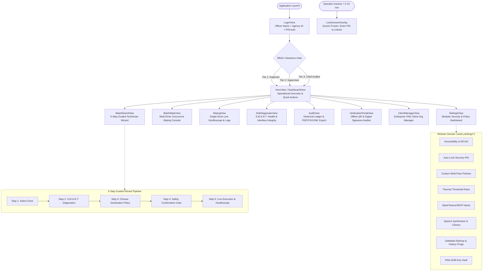
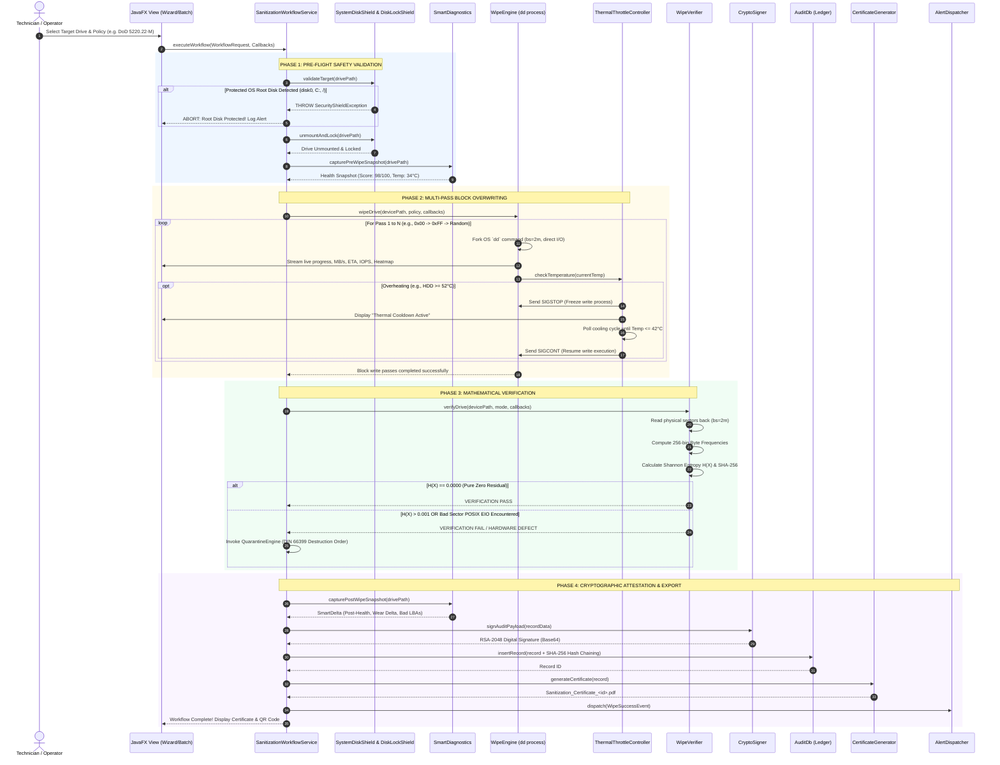
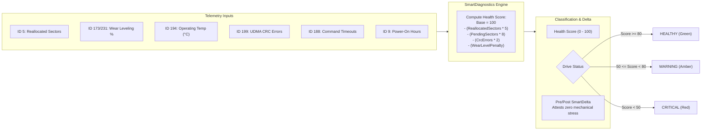
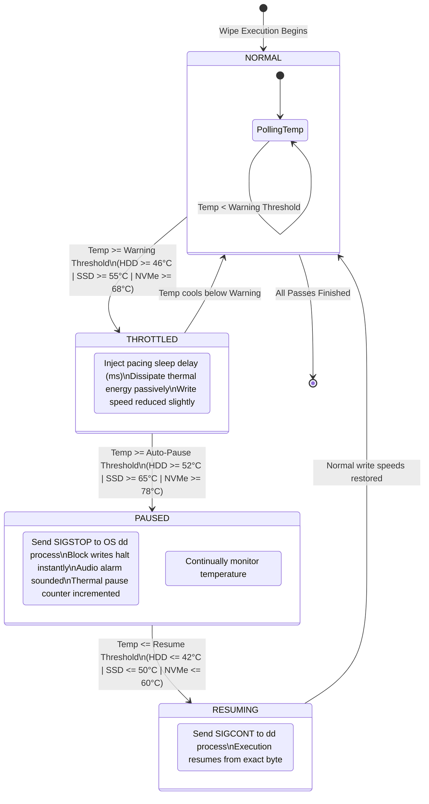
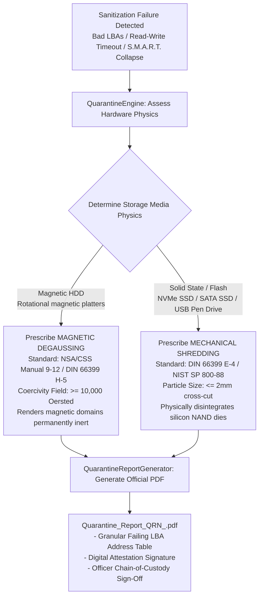
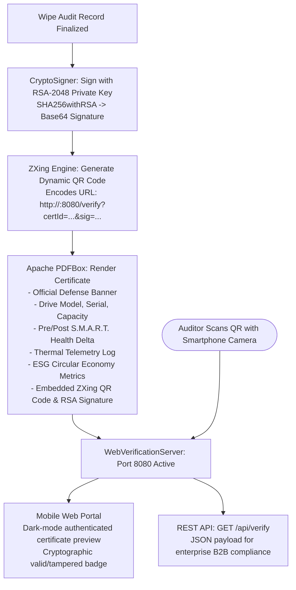
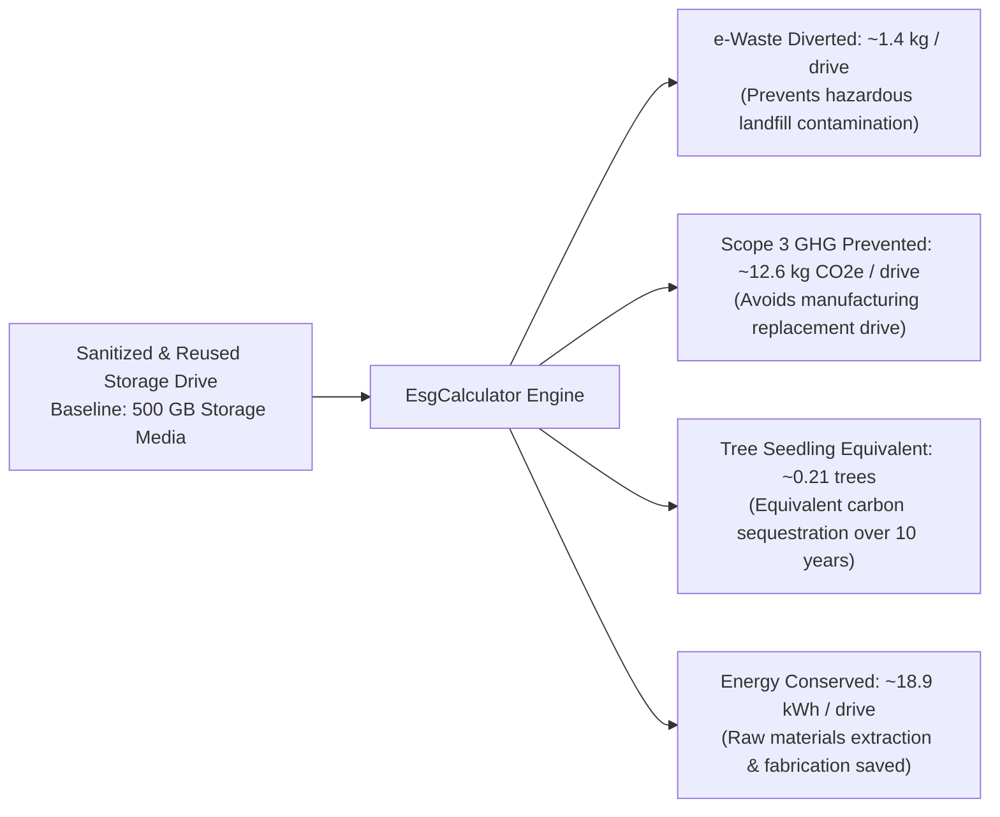
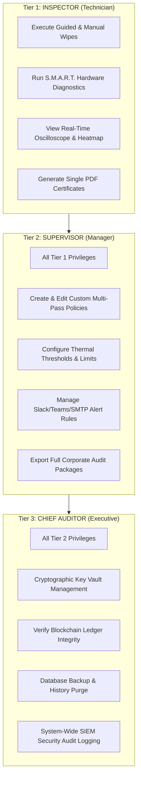

# 🛡️ Secure-Data-Wiping (SecureErase Pro Enterprise)
### *Defense-Grade Storage Media Sanitization, Cryptographic Ledger & Hardware Lifecycle Assurance*

```
========================================================================================
  STANDARDS COMPLIANCE : NIST SP 800-88 Rev. 1 | DoD 5220.22-M | DoD ECE | BSI-VS | HMG IS5
  SECURITY & AUDIT     : RSA-2048 | SHA-256 Hash Chain | DIN 66399 | HIPAA | GDPR Art. 17
  TECHNOLOGY STACK     : Java 17 LTS | JavaFX 21 | OSHI | Apache PDFBox | ZXing | SQLite WAL
========================================================================================
```

---

## 🗺️ Quick Navigation Index

- [1. Executive Overview & Mission Architecture](#1-executive-overview--mission-architecture)
- [2. Interactive UI & Navigation Flow Map](#2-interactive-ui--navigation-flow-map)
- [3. Complete End-to-End System Architecture](#3-complete-end-to-end-system-architecture)
- [4. Core Workflow Execution (Sequence Diagram)](#4-core-workflow-execution-sequence-diagram)
- [5. Defensive Safety Shields & Root Disk Protection](#5-defensive-safety-shields--root-disk-protection)
- [6. Hardware Diagnostics & S.M.A.R.T. Health Scoring Engine](#6-hardware-diagnostics--smart-health-scoring-engine)
- [7. Thermal Throttle Controller & State Machine](#7-thermal-throttle-controller--state-machine)
- [8. Sanitization Standards & Multi-Pass Bit Patterns](#8-sanitization-standards--multi-pass-bit-patterns)
- [9. Mathematical Verification & Shannon Entropy Model](#9-mathematical-verification--shannon-entropy-model)
- [10. Cryptographic Blockchain Ledger & Tamper Proofing](#10-cryptographic-blockchain-ledger--tamper-proofing)
- [11. Hardware Quarantine & DIN 66399 Physical Destruction](#11-hardware-quarantine--din-66399-physical-destruction)
- [12. Digital PDF Certification & Offline QR Verification Portal](#12-digital-pdf-certification--offline-qr-verification-portal)
- [13. Environmental ESG & ITAD Carbon Calculator](#13-environmental-esg--itad-carbon-calculator)
- [14. Role-Based Access Control (RBAC) & Session Governance](#14-role-based-access-control-rbac--session-governance)
- [15. Complete Package & File Directory Blueprint](#15-complete-package--file-directory-blueprint)
- [16. High-Yield Viva, Defense & Interview Masterclass](#16-high-yield-viva-defense--interview-masterclass)
- [17. Build, Test & Deployment Playbook](#17-build-test--deployment-playbook)

---

## 1. Executive Overview & Mission Architecture

```
┌────────────────────────────────────────────────────────────────────────────────────────┐
│                                 THE 6 CORE PILLARS                                     │
├──────────────────────────┬──────────────────────────┬──────────────────────────────────┤
│ 1. PERMANENT PHYSICAL    │ 2. ZERO-RESIDUAL         │ 3. CRYPTOGRAPHIC                 │
│    DATA DESTRUCTION      │    ENTROPY PROOF         │    IMMUTABLE LEDGER              │
│ Direct OS block write    │ Shannon Entropy H(X)     │ SHA-256 blockchain hash chaining │
│ targeting /dev/rdisk*    │ returns exactly 0.0000   │ + RSA-2048 digital signatures    │
├──────────────────────────┼──────────────────────────┼──────────────────────────────────┤
│ 4. HARDWARE QUARANTINE   │ 5. HOST SAFETY SHIELDS   │ 6. ESG & CIRCULAR                │
│    DEFECT ISOLATION      │    & THERMAL THROTTLE    │    ECONOMY METRICS               │
│ Auto-aborts on bad LBAs; │ Triple-layer boot guard; │ Quantifies kg e-waste diverted   │
│ DIN 66399 destruction    │ SIGSTOP/SIGCONT pauses   │ & Scope 3 CO2 emissions saved    │
└──────────────────────────┴──────────────────────────┴──────────────────────────────────┘
```

> [!IMPORTANT]
> **Why Software Sanitization Matters**: Simply deleting a file or formatting a drive only clears the filesystem partition table (FAT, NTFS, APFS). The underlying binary bits remain completely recoverable using raw sector carving tools (e.g., `TestDisk`, `Photorec`). **SecureErase Pro** writes low-level cryptographic patterns directly across every addressable Logical Block Address (LBA), rendering forensic data recovery physically impossible.

---

## 2. Interactive UI & Navigation Flow Map

This flowchart maps the user journey across the JavaFX presentation layer orchestrated by `NavigationManager.java`:



---

## 3. Complete End-to-End System Architecture

A modular 7-tier architecture separating presentation, session security, business services, safety shields, hardware execution, mathematical verification, and cryptographic output:

```mermaid
graph TB
    subgraph T1["1. PRESENTATION LAYER (JavaFX 21 & CSS Design System)"]
        NAV[NavigationManager Router]
        V_WIZ[WipeWizardView]
        V_BAT[BatchWipeView]
        V_AUD[AuditView]
        V_DIA[DiskDiagnosticView]
        C_HEAT[SectorHeatmapComponent]
        C_OSC[IoOscilloscopeComponent]
        C_THERM[ThermalGraphComponent]
        NAV --> V_WIZ & V_BAT & V_AUD & V_DIA
        V_WIZ & V_BAT -.-> C_HEAT & C_OSC & C_THERM
    end

    subgraph T2["2. SESSION & SECURITY LAYER"]
        AUTH[LoginView & PIN Manager]
        CTX[SessionContext: UserRole Tier 1/2/3]
        AUTOLOCK[SessionAutoLockManager]
        AUTH --> CTX --> AUTOLOCK
    end

    subgraph T3["3. APPLICATION ORCHESTRATION LAYER"]
        SW_SVC[SanitizationWorkflowService]
        EXP_SVC[AuditExportService]
        CFG_SVC[SystemConfigurationService]
    end

    subgraph T4["4. DEFENSIVE HARDWARE SHIELDS"]
        SHIELD_SYS[SystemDiskShield\nBlocks disk0, C:, /dev/sda & Live Mounts]
        SHIELD_LOCK[DiskLockShield\nUnmounts Logical Partitions via diskutil/umount]
        SHIELD_GOV[WorkerPoolGovernor\nHost CPU <= 88% & RAM >= 512MB Guard]
    end

    subgraph T5["5. HARDWARE EXECUTION & DIAGNOSTICS"]
        DET_USB[UsbDetector: OSHI Poller]
        DIAG_SMART[SmartDiagnostics: 0-100 Score]
        ENG_WIPE[WipeEngine: dd Process bs=2m]
        CTRL_THERM[ThermalThrottleController: SIGSTOP/SIGCONT]
        ENG_WIPE <--> CTRL_THERM
    end

    subgraph T6["6. VERIFICATION & QUARANTINE ENGINE"]
        VERIF[WipeVerifier\nShannon Entropy H(X) & SHA-256 Proof]
        QRN_ENG[QuarantineEngine\nAssesses Unrecoverable Bad LBAs]
    end

    subgraph T7["7. CRYPTOGRAPHIC LEDGER & COMPLIANCE OUTPUT"]
        CRYPTO[CryptoSigner: RSA-2048 / SHA256withRSA]
        DB[(AuditDb SQLite WAL\nSHA-256 Blockchain Hash Chaining)]
        LEDGER_ENG[LedgerIntegrityEngine\nMathematical Tamper Detector]
        PDF_GEN[CertificateGenerator: Apache PDFBox]
        QRN_GEN[QuarantineReportGenerator: DIN 66399 Orders]
        HTTP_SRV[WebVerificationServer: Sun HttpServer :8080]
        ALERT_DISP[AlertDispatcher: Webhooks & SMTP]
        ESG_CALC[EsgCalculator: CO2e & E-Waste Math]
    end

    T1 --> T2
    T2 --> T3
    T3 --> T4
    T4 --> T5
    T5 --> T6
    
    VERIF -->|PASS: H(X) == 0.0000| CRYPTO
    VERIF -->|FAIL: Hardware Defect / I/O Fault| QRN_ENG
    
    CRYPTO --> DB & LEDGER_ENG & PDF_GEN & ALERT_DISP & ESG_CALC
    PDF_GEN --> HTTP_SRV
    QRN_ENG --> QRN_GEN
```

---

## 4. Core Workflow Execution (Sequence Diagram)

This detailed sequence diagram illustrates the lifecycle of a complete sanitization operation across all service boundaries:



---

## 5. Defensive Safety Shields & Root Disk Protection

The application enforces a **3-Layer Defensive Interceptor** in `SystemDiskShield.java` to make accidental destruction of the host operating system physically impossible:

```mermaid
flowchart TD
    INPUT([Operator Selects Drive Path]) --> L1{LAYER 1: HARDCODED ROOT SIGNATURES\nCheck target against OS root patterns}
    
    L1 -->|Matches: disk0, rdisk0 (macOS)\nPhysicalDrive0, C: (Win)\n/dev/sda, /dev/nvme0n1 (Linux)| REJECT[REJECT OPERATION IMMEDIATELY]
    
    L1 -->|Clean| L2{LAYER 2: LIVE FILESYSTEM MOUNT INSPECTION\nOSHI queries active mounts:\n/, /boot, /System, /etc, C:\\Windows}
    
    L2 -->|Matches Active Mount| REJECT
    
    L2 -->|Clean| L3{LAYER 3: PARTITION GEOMETRY & PARENT DISK\nDoes the target partition share physical\ngeometry with the host OS boot device?}
    
    L3 -->|Geometry Matches Host OS| REJECT
    
    L3 -->|Clean| CAPACITY{CAPACITY BOUNDARY VALIDATION\nIs capacity within valid target range\n(Default: 1 GB <= Size <= 128 GB)?}
    
    CAPACITY -->|Out of Bounds| REJECT
    CAPACITY -->|Approved| UNMOUNT[PASSED TO DISKLOCKSHIELD\nExecute diskutil unmountDisk / umount -f\nAcquire exclusive block lock]
    
    REJECT --> LOG_VIOLATION[SecurityAuditLogger: Log Unauthorized Path\nAlertDispatcher: Fire Admin Shield Alert]
```

### Protection Code Reference:
```java
// From SystemDiskShield.java
public static boolean isSystemDisk(String diskPath) {
    if (diskPath == null || diskPath.isBlank()) return true;
    String clean = diskPath.toLowerCase().trim();

    // Layer 1: Platform root signatures
    if (clean.contains("disk0") || clean.contains("rdisk0") ||
        clean.contains("physicaldrive0") || clean.startsWith("c:") ||
        clean.equals("/dev/sda") || clean.equals("/dev/nvme0n1")) {
        return true;
    }

    // Layer 2: Deep live mount inspection
    return isMountedAsRootOrSystem(clean);
}
```

---

## 6. Hardware Diagnostics & S.M.A.R.T. Health Scoring Engine

The diagnostic engine evaluates storage drive physics via S.M.A.R.T. telemetry attributes:



---

## 7. Thermal Throttle Controller & State Machine

Storage drives—especially NVMe SSDs and USB 3.2 thumb drives—heat up dramatically during continuous full-speed overwrites. Overheating causes NAND flash degradation and write-head wear. `ThermalThrottleController.java` manages a dynamic state machine:



### Device-Specific Thermal Threshold Table:
| Media Type | Warning Threshold | Auto-Pause (`SIGSTOP`) | Auto-Resume (`SIGCONT`) |
| :--- | :---: | :---: | :---: |
| **Magnetic HDD** | $46^\circ\text{C}$ | $52^\circ\text{C}$ | $42^\circ\text{C}$ |
| **SATA SSD** | $55^\circ\text{C}$ | $65^\circ\text{C}$ | $50^\circ\text{C}$ |
| **NVMe SSD** | $68^\circ\text{C}$ | $78^\circ\text{C}$ | $60^\circ\text{C}$ |
| **USB Flash Drive** | $48^\circ\text{C}$ | $58^\circ\text{C}$ | $44^\circ\text{C}$ |

---

## 8. Sanitization Standards & Multi-Pass Bit Patterns

Different defense and international compliance bodies prescribe specific overwriting sequences:

```mermaid
flowchart TD
    subgraph NIST["NIST SP 800-88 Rev. 1 Clear (1 Pass)"]
        N1["Pass 1: 0x00 (Fixed Zero Fill)"]
    end

    subgraph DOD["US DoD 5220.22-M NISPOM (3 Passes)"]
        D1["Pass 1: 0x00 (Zero Fill)"] --> D2["Pass 2: 0xFF (One Fill)"] --> D3["Pass 3: PRNG (Cryptographic Pseudo-Random)"]
    end

    subgraph DODECE["US DoD 5220.22-M ECE (7 Passes)"]
        DE1["Pass 1: 0x00"] --> DE2["Pass 2: 0xFF"] --> DE3["Pass 3: Random"] --> DE4["Pass 4: 0x96"] --> DE5["Pass 5: 0x00"] --> DE6["Pass 6: 0xFF"] --> DE7["Pass 7: Random"]
    end

    subgraph BSI["German BSI-VS / TL-03423 (7 Passes)"]
        B1["Pass 1: 0x00"] --> B2["Pass 2: 0xFF"] --> B3["Pass 3: 0x00"] --> B4["Pass 4: 0xFF"] --> B5["Pass 5: 0xAA"] --> B6["Pass 6: 0x55"] --> B7["Pass 7: Random"]
    end
```



### Standards Comparison Matrix:
| Standard Name | Origin | Passes | Pattern Progression | Target Security Level |
| :--- | :--- | :---: | :--- | :--- |
| **NIST SP 800-88 Clear** | USA (NIST) | 1 | `0x00` | Commercial / Enterprise General |
| **DoD 5220.22-M** | USA (DoD) | 3 | `0x00` $\to$ `0xFF` $\to$ Random | Confidential / Defense Standard |
| **DoD 5220.22-M ECE** | USA (DoD) | 7 | `0x00` $\to$ `0xFF` $\to$ Rand $\to$ `0x96` $\to$ `0x00` $\to$ `0xFF` $\to$ Rand | Top Secret / Military High Security |
| **HMG IS5 Enhanced** | UK (CESG) | 3 | `0x00` $\to$ `0xFF` $\to$ Random | UK Crown & Government Standard |
| **BSI-VS / TL-03423** | Germany (BSI) | 7 | `0x00` $\to$ `0xFF` $\to$ `0x00` $\to$ `0xFF` $\to$ `0xAA` $\to$ `0x55` $\to$ Rand | German Federal Classified Data |
| **RCMP TSSIT OPS-II** | Canada (RCMP) | 7 | `0x00` $\to$ `0xFF` $\to$ `0x00` $\to$ `0xFF` $\to$ `0xAA` $\to$ `0x55` $\to$ Rand | Canadian Federal Protected |

---

## 9. Mathematical Verification & Shannon Entropy Model

Post-wipe compliance auditing mathematically proves zero data remanence using **Information Theory**:

```mermaid
flowchart TD
    RAW[Read Raw Physical Block Stream from Storage Media] --> HIST[Build 256-Bin Byte Frequency Histogram\nCounts of 0x00, 0x01, ..., 0xFF]
    HIST --> PROB["Calculate Probability Distribution:\np(x_i) = Frequency(x_i) / TotalBytesSampled"]
    PROB --> FORMULA["Compute Shannon Entropy:\nH(X) = - SUM [ p(x_i) * log2( p(x_i) ) ]"]
    
    FORMULA --> EVAL{Evaluate H(X)}
    
    EVAL -->|H(X) == 0.0000\n100% of bytes are 0x00| PASS["VERIFICATION PASS\nZero data remanence mathematically attested\nReadback SHA-256 Digest Created"]
    EVAL -->|H(X) > 0.001\nNon-zero residual bits detected| FAIL["VERIFICATION FAIL\nMedia contaminated! Data survived overwrite!\nTrigger Quarantine Engine"]
```

### The Mathematics:
$$\text{Shannon Entropy: } H(X) = -\sum_{i=0}^{255} p(x_i) \log_2 p(x_i)$$

* **Perfect Zero-Fill**:
  If all bytes are `0x00`, then $p(0\text{x}00) = 1.0$ and all other $p(x_i) = 0$.
  $$H(X) = -(1.0 \times \log_2(1.0)) = -(1.0 \times 0) = \mathbf{0.0000\text{ bits/byte}}$$
* **Random or Residual Data**:
  If residual encrypted or un-wiped data remains, the bytes are distributed across multiple bins, yielding $H(X) \approx 7.9 - 8.0\text{ bits/byte}$.
* **Pass Criterion**: Verification passes **only if $H(X) \le 0.001\text{ bits/byte}$**.

---

## 10. Cryptographic Blockchain Ledger & Tamper Proofing

Every sanitization record is permanently sealed into an internal SQLite database (`sanitizer_history.db`) operating in high-concurrency WAL mode (`PRAGMA journal_mode=WAL;`).

```mermaid
flowchart LR
    subgraph GENESIS["Block #0 (Genesis Root Anchor)"]
        G_HASH["Genesis Hash:\n00000000000000000000000000000000..."]
    end

    subgraph BLOCK1["Block #1: Drive Serial ST2000"]
        P1["Payload: ID=1 | DoD 3-Pass | PASS | RSA Sig"]
        PREV1["prev_hash: 00000000..."]
        H1["record_hash:\nSHA-256(prev_hash || P1)"]
    end

    subgraph BLOCK2["Block #2: Drive Serial WD5000"]
        P2["Payload: ID=2 | NIST Clear | PASS | RSA Sig"]
        PREV2["prev_hash: H1"]
        H2["record_hash:\nSHA-256(H1 || P2)"]
    end

    subgraph BLOCK3["Block #3: Drive Serial SAM980"]
        P3["Payload: ID=3 | BSI-VS 7-Pass | PASS | RSA Sig"]
        PREV3["prev_hash: H2"]
        H3["record_hash:\nSHA-256(H2 || P3)"]
    end

    GENESIS --> BLOCK1
    BLOCK1 --> BLOCK2
    BLOCK2 --> BLOCK3

    style BLOCK1 fill:#f0f9ff,stroke:#0284c7
    style BLOCK2 fill:#f0f9ff,stroke:#0284c7
    style BLOCK3 fill:#f0f9ff,stroke:#0284c7
```



> [!CAUTION]
> **Tamper Detection in Action**:
> If an attacker opens `sanitizer_history.db` using an external SQLite browser and alters Block #2 (e.g. changing `FAIL` to `PASS`):
> 1. The recomputed `record_hash` for Block #2 changes.
> 2. Block #3's `prev_record_hash` will no longer match Block #2's new hash.
> 3. `LedgerIntegrityEngine.verifyLedger()` immediately detects the corruption, stops the application, and flags the exact record ID that was tampered with.

---

## 11. Hardware Quarantine & DIN 66399 Physical Destruction

When a drive encounters bad sectors (`POSIX EIO`), software sanitization **cannot guarantee complete erasure**. The system automatically triggers the Quarantine Protocol:



---

## 12. Digital PDF Certification & Offline QR Verification Portal



---

## 13. Environmental ESG & ITAD Carbon Calculator

When drives are sanitized and reused rather than physically destroyed, substantial electronic waste and manufacturing emissions are avoided:



### ESG Formulas:
$$\text{e-Waste Diverted (kg)} = N_{\text{drives}} \times 1.4\text{ kg} \times \left(\frac{\text{Capacity in GB}}{500}\right)^{0.25}$$
$$\text{Scope 3 CO}_2\text{e Saved (kg)} = N_{\text{drives}} \times 12.6\text{ kg} \times \left(\frac{\text{Capacity in GB}}{500}\right)^{0.30}$$

---

## 14. Role-Based Access Control (RBAC) & Session Governance

The system enforces strict principle-of-least-privilege clearance tiers:



---

## 15. Complete Package & File Directory Blueprint

```
DWproject/
├── README.md                          # Repository overview
├── PROJECT_STUDY_GUIDE.md             # This comprehensive master manual
├── dist/                              # Compiled native installation packages
│   └── USBSanitizer-1.0.0.dmg         # macOS DMG distribution installer
├── packaging/                         # Multi-platform installer build toolchain
│   ├── build-all.sh                   # Master platform detection & packaging router
│   ├── package-mac.sh                 # macOS DMG & App bundle packager (jpackage)
│   ├── package-linux.sh               # Linux RPM / DEB packager
│   ├── package-appimage.sh            # Linux portable AppImage builder
│   ├── package-flatpak.sh             # Linux Flatpak packaging script
│   └── package-win.bat / .ps1         # Windows MSI / EXE / ZIP packaging scripts
├── .github/workflows/                 # CI/CD automation pipelines
│   ├── ci.yml                         # Automated Maven compile and 34 JUnit 5 tests
│   └── release.yml                    # Multi-platform release artifact generation
└── DataWiping/                        # Core Java Application Maven Module
    ├── pom.xml                        # Maven dependencies & build configurations
    └── src/
        ├── main/resources/            # Application assets, styling, and i18n
        │   ├── css/style.css          # Executive theme design system (~1,670 lines)
        │   ├── icons/icon.png         # High-resolution application brand icon
        │   └── i18n/messages_*.props  # Localized strings: EN, DE, FR, ES, HI
        ├── test/java/com/sanitizer/   # 34 comprehensive JUnit 5 test suites (100% passing)
        └── main/java/com/sanitizer/   # Core source packages
```

### Complete Source Code File Map:

| Package | Class / File | Architectural Responsibility |
| :--- | :--- | :--- |
| `service` | [SanitizationWorkflowService.java](file:///Users/pranaash31/IdeaProjects/DWproject/DataWiping/src/main/java/com/sanitizer/service/SanitizationWorkflowService.java) | Master orchestrator: coordinates diagnostics, wiping, verification, digital seal, audit, and quarantine |
| `service` | [AuditExportService.java](file:///Users/pranaash31/IdeaProjects/DWproject/DataWiping/src/main/java/com/sanitizer/service/AuditExportService.java) | Asynchronous exporter for CSV, JSON, and Excel SpreadsheetML (XML) reports |
| `service` | [SystemConfigurationService.java](file:///Users/pranaash31/IdeaProjects/DWproject/DataWiping/src/main/java/com/sanitizer/service/SystemConfigurationService.java) | Decoupled configuration orchestrator for database backups, alert webhooks, and thermal rules |
| `engine` | [WipeEngine.java](file:///Users/pranaash31/IdeaProjects/DWproject/DataWiping/src/main/java/com/sanitizer/engine/WipeEngine.java) | Overwrites raw block devices via `dd`, manages worker threads, pauses on thermal events |
| `engine` | [WipeVerifier.java](file:///Users/pranaash31/IdeaProjects/DWproject/DataWiping/src/main/java/com/sanitizer/engine/WipeVerifier.java) | Calculates Shannon Entropy ($H(X)$), verifies 0x00 pattern, produces SHA-256 proof |
| `shield` | [SystemDiskShield.java](file:///Users/pranaash31/IdeaProjects/DWproject/DataWiping/src/main/java/com/sanitizer/shield/SystemDiskShield.java) | Evaluates disk paths, protects OS root partitions (`disk0`, `C:`, `/dev/sda`) |
| `shield` | [DiskLockShield.java](file:///Users/pranaash31/IdeaProjects/DWproject/DataWiping/src/main/java/com/sanitizer/shield/DiskLockShield.java) | Unmounts logical partitions and locks devices against OS automount daemons |
| `shield` | [WorkerPoolGovernor.java](file:///Users/pranaash31/IdeaProjects/DWproject/DataWiping/src/main/java/com/sanitizer/shield/WorkerPoolGovernor.java) | Regulates host CPU load ($\le 88\%$) and memory to throttle parallel wipe dispatching |
| `detector` | [UsbDetector.java](file:///Users/pranaash31/IdeaProjects/DWproject/DataWiping/src/main/java/com/sanitizer/detector/UsbDetector.java) | Background OSHI hardware poller discovering removable pen drives and block devices |
| `detector` | [SmartDiagnostics.java](file:///Users/pranaash31/IdeaProjects/DWproject/DataWiping/src/main/java/com/sanitizer/detector/SmartDiagnostics.java) | Evaluates S.M.A.R.T. attributes, calculates 0-100 health score, tracks wear delta |
| `detector` | [ThermalThrottleController.java](file:///Users/pranaash31/IdeaProjects/DWproject/DataWiping/src/main/java/com/sanitizer/detector/ThermalThrottleController.java) | Computes throttle delays and auto-pauses when media exceeds thermal limits |
| `policy` | [WipePolicyManager.java](file:///Users/pranaash31/IdeaProjects/DWproject/DataWiping/src/main/java/com/sanitizer/policy/WipePolicyManager.java) | Registry for NIST SP 800-88, DoD 5220.22-M, BSI, HMG, RCMP and custom JSON policies |
| `crypto` | [CryptoSigner.java](file:///Users/pranaash31/IdeaProjects/DWproject/DataWiping/src/main/java/com/sanitizer/crypto/CryptoSigner.java) | Generates RSA-2048 keys and digitally signs compliance proofs using SHA256withRSA |
| `db` | [AuditDb.java](file:///Users/pranaash31/IdeaProjects/DWproject/DataWiping/src/main/java/com/sanitizer/db/AuditDb.java) | SQLite WAL database storing complete historical audit records |
| `db` | [LedgerIntegrityEngine.java](file:///Users/pranaash31/IdeaProjects/DWproject/DataWiping/src/main/java/com/sanitizer/db/LedgerIntegrityEngine.java) | Verifies SHA-256 blockchain-style chaining to mathematically detect database tampering |
| `audit` | [SecurityAuditLogger.java](file:///Users/pranaash31/IdeaProjects/DWproject/DataWiping/src/main/java/com/sanitizer/audit/SecurityAuditLogger.java) | Chained security audit trail logging logins, policy changes, and access denials |
| `pdf` | [CertificateGenerator.java](file:///Users/pranaash31/IdeaProjects/DWproject/DataWiping/src/main/java/com/sanitizer/pdf/CertificateGenerator.java) | Creates tamper-proof PDF certificates with Apache PDFBox and embedded ZXing QR code |
| `server` | [WebVerificationServer.java](file:///Users/pranaash31/IdeaProjects/DWproject/DataWiping/src/main/java/com/sanitizer/server/WebVerificationServer.java) | Embedded HTTP server (port 8080) for live mobile QR verification and REST API |
| `quarantine`| [QuarantineEngine.java](file:///Users/pranaash31/IdeaProjects/DWproject/DataWiping/src/main/java/com/sanitizer/quarantine/QuarantineEngine.java) | Assesses hardware write faults and prescribes DIN 66399 degaussing or shredding |
| `quarantine`| [QuarantineReportGenerator.java](file:///Users/pranaash31/IdeaProjects/DWproject/DataWiping/src/main/java/com/sanitizer/quarantine/QuarantineReportGenerator.java) | Generates formal PDF destruction work orders with failing LBA fault logs |
| `session` | [UserRole.java](file:///Users/pranaash31/IdeaProjects/DWproject/DataWiping/src/main/java/com/sanitizer/session/UserRole.java) | Defines Tier 1 Inspector, Tier 2 Supervisor, and Tier 3 Chief Auditor RBAC hierarchy |
| `alert` | [AlertDispatcher.java](file:///Users/pranaash31/IdeaProjects/DWproject/DataWiping/src/main/java/com/sanitizer/alert/AlertDispatcher.java) | Dispatches notifications to Slack/Teams webhooks and SMTP email servers |
| `esg` | [EsgCalculator.java](file:///Users/pranaash31/IdeaProjects/DWproject/DataWiping/src/main/java/com/sanitizer/esg/EsgCalculator.java) | Computes avoided e-waste (kg), CO2e emissions saved, and tree seedling equivalencies |
| `report` | [AuditExporter.java](file:///Users/pranaash31/IdeaProjects/DWproject/DataWiping/src/main/java/com/sanitizer/report/AuditExporter.java) | Exports audit records to CSV, structured JSON, and Excel SpreadsheetML (XML) |
| `gui` | [NavigationManager.java](file:///Users/pranaash31/IdeaProjects/DWproject/DataWiping/src/main/java/com/sanitizer/gui/navigation/NavigationManager.java) | App router, view cache, RBAC enforcer, shortcut dispatcher, and scene manager |
| `gui` | [SettingsView.java](file:///Users/pranaash31/IdeaProjects/DWproject/DataWiping/src/main/java/com/sanitizer/gui/views/SettingsView.java) | Modular settings dashboard container assembling domain cards |

---

## 16. High-Yield Viva, Defense & Interview Masterclass

Use these authoritative answers to ace technical viva examinations, project defenses, and system design interviews.

### Q1: Why does your application write directly to raw character devices (`/dev/rdisk*`) instead of standard file I/O?
> **Model Answer**: Standard file I/O operations go through the operating system's Virtual File System (VFS), filesystem cache, and kernel write buffers. The OS may delay writing, cache writes in RAM, or skip blocks via wear-leveling/journaling. By opening raw block devices (e.g. `/dev/rdisk*` on macOS, `/dev/sd*` on Linux, `\\\\.\\PhysicalDrive*` on Windows) with `bs=2m`, we bypass kernel caching layers and write directly to physical sectors on the storage media. This is a mandatory requirement of NIST SP 800-88 Rev. 1 for media sanitization.

### Q2: How does Shannon Entropy mathematically prove that a drive has zero residual data?
> **Model Answer**: Shannon Entropy measures the average information density (uncertainty) in bits per byte across a probability distribution of 256 byte values ($0\text{x}00$ through $0\text{xFF}$):
> $$H(X) = -\sum_{i=0}^{255} p(x_i) \log_2 p(x_i)$$
> If a drive has been completely sanitized with zero-fill, 100% of the bytes read back are `0x00` ($p(0\text{x}00) = 1.0$, and all other $p(x_i) = 0$). Since $1 \times \log_2(1) = 0$, the entropy score is **exactly $0.0000\text{ bits/byte}$**. If even a single byte or residual file fragment survives, $H(X) > 0.001$, which immediately fails verification and flags the drive as contaminated.

### Q3: How do you prevent accidental destruction of the host operating system drive?
> **Model Answer**: We employ a three-tier defense-in-depth shield implemented in `SystemDiskShield.java`:
> 1. **Hardcoded Root Signatures**: Rejects known OS system drive paths across all platforms (`disk0`, `rdisk0` on macOS; `PhysicalDrive0`, `C:` on Windows; `/dev/sda`, `/dev/nvme0n1` on Linux).
> 2. **OSHI Live Mount Inspection**: Queries active OS filesystem mounts (`/`, `/boot`, `/System`, `/etc`, `C:\Windows`) and forbids any drive matching an active mount.
> 3. **Partition Geometry Correlation**: Rejects secondary partitions that share physical device geometry with the host boot disk. Any violation triggers immediate rejection and logs a security alert.

### Q4: How is your SQLite audit log tamper-evident?
> **Model Answer**: We implement a **cryptographic blockchain-style hash chain** in `AuditDb.java` and `LedgerIntegrityEngine.java`. Each audit record contains:
> $$\text{record\_hash} = \text{SHA-256}(\text{prev\_record\_hash} \parallel \text{record\_payload})$$
> The very first record is anchored to a known **Genesis Root Hash** (`0000...0000`). If a malicious user directly edits an SQLite row (e.g. altering a failed wipe to `PASS` or deleting a record), the hash sequence breaks. The `LedgerIntegrityEngine` can mathematically verify the entire chain and identify the exact tampered row. In addition, each record is digitally signed with an **RSA-2048 private key**.

### Q5: What happens if a storage device overheats during wiping?
> **Model Answer**: `ThermalThrottleController` evaluates device temperature in real-time against device-specific thermal profiles (HDDs pause at 52°C, SSDs at 65°C, NVMe at 78°C). If temperature exceeds the warning threshold, the controller injects pacing delays. If it hits the auto-pause limit, the application sends a **`SIGSTOP`** signal to the underlying `dd` process to freeze I/O immediately without aborting the job. When the drive cools down below the resume threshold, it sends **`SIGCONT`** to resume writing from the exact byte where it paused.

### Q6: Why can't bad sectors simply be overwritten, and what is your Quarantine protocol?
> **Model Answer**: Bad sectors are physical media defects (degraded magnetic media or worn-out NAND flash cells) that generate unrecoverable `POSIX EIO` errors. Because the drive's internal controller cannot write to these defective LBAs, **software overwriting is physically impossible**. Residual sensitive data may still reside inside those cells. Therefore, per NIST SP 800-88 Rev. 1 § 4.7 and EU GDPR Article 17, our `QuarantineEngine` aborts the software wipe, quarantines the drive, and generates a **DIN 66399 Physical Destruction Work Order** prescribing either **Magnetic Degaussing** (for HDDs, $\ge 10,000\text{ Oe}$) or **Mechanical Shredding** (for SSDs/Flash, $\le 2\text{mm}$).

### Q7: How does the offline QR code verification portal work?
> **Model Answer**: The application includes an embedded zero-dependency HTTP server (`WebVerificationServer.java`) listening on port 8080. When a certificate is generated via Apache PDFBox, a **ZXing QR Code** is embedded into the PDF linking to:
> `http://<host>:8080/verify?certId=<id>&model=<model>&sig=<signature>`
> When an auditor or client scans the QR code with their mobile phone camera, the server validates the RSA-2048 signature in real-time, displays an official cryptographic verification badge, and exposes a REST API (`/api/verify`) for automated enterprise compliance checks.

### Q8: What ESG (Environmental, Social, Governance) metrics does the application compute?
> **Model Answer**: In IT Asset Disposition (ITAD), physically shredding a reusable drive generates electronic waste and requires manufacturing a replacement drive. `EsgCalculator.java` models circular economy benefits: For every 500GB drive safely wiped and reused rather than shredded, it calculates:
> * $\approx 1.4\text{ kg}$ of electronic waste diverted from landfills.
> * $\approx 12.6\text{ kg}$ of Scope 3 greenhouse gas ($\text{CO}_2\text{e}$) emissions prevented.
> * $\approx 0.21$ tree seedlings grown for 10 years equivalent.
> * $\approx 18.9\text{ kWh}$ of energy conserved.
> These metrics are embedded into every PDF certificate and audit report.

---

## 17. Build, Test & Deployment Playbook

### 17.1. Prerequisites
* **Java Development Kit (JDK)**: Version 17 LTS or higher.
* **Apache Maven**: Version 3.8+ (`mvn`).

### 17.2. Launching Locally (JavaFX)
```bash
cd DataWiping
mvn javafx:run
```
*(Or execute main class `com.sanitizer.gui.AppLauncher` directly from IntelliJ IDEA).*

### 17.3. Running All 34 Unit & Integration Tests
```bash
cd DataWiping
mvn test
```
*(JaCoCo test coverage report generated in `DataWiping/target/site/jacoco/index.html`)*.

### 17.4. Building Shaded Executable Uber-JAR
```bash
cd DataWiping
mvn clean package
# Output: DataWiping/target/usb-sanitizer-1.0-SNAPSHOT-all.jar
```

### 17.5. Multi-Platform Installer Packaging
* **macOS (DMG Installer via jpackage)**:
  ```bash
  ./packaging/package-mac.sh 1.0.0
  # Output: dist/USBSanitizer-1.0.0.dmg
  ```
* **Linux (AppImage / DEB / Flatpak)**:
  ```bash
  ./packaging/package-linux.sh 1.0.0
  ./packaging/package-appimage.sh 1.0.0
  ./packaging/package-flatpak.sh 1.0.0
  ```
* **Windows (MSI / EXE)**:
  ```cmd
  packaging\package-win.bat 1.0.0
  ```
