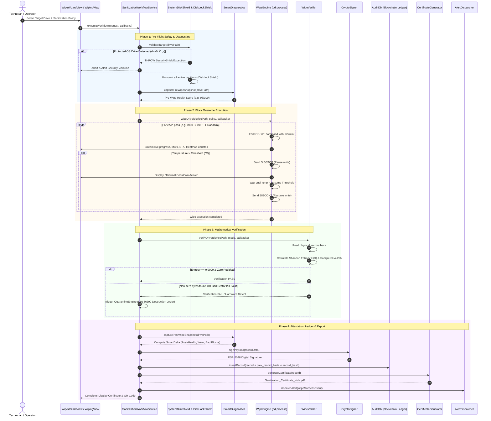
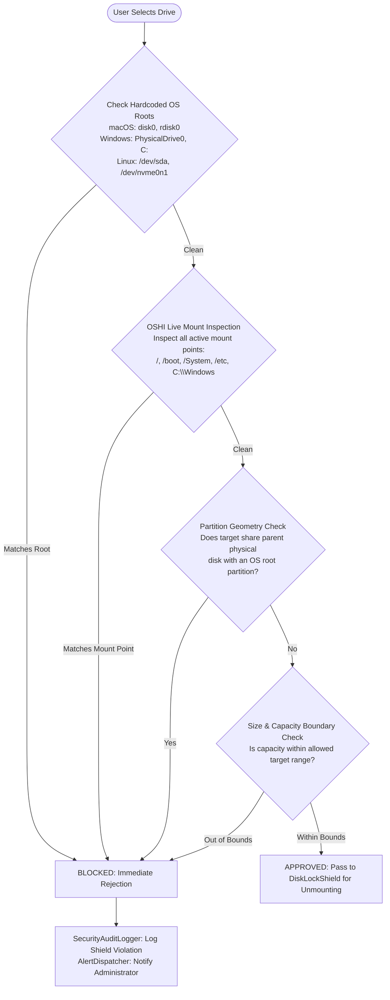
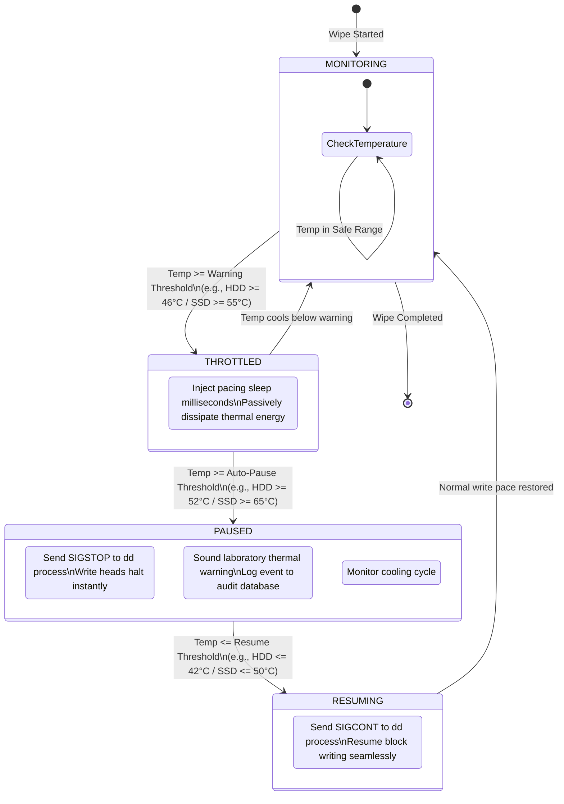
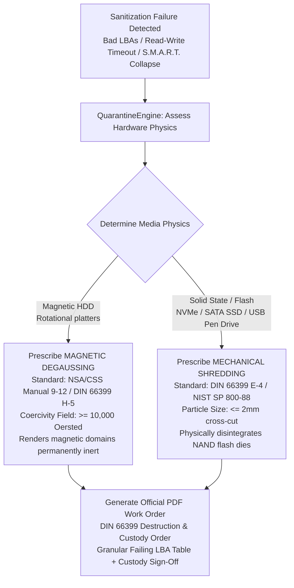

# Secure-Data-Wiping: Enterprise Architecture & Project Study Guide

> **Official Standard Compliance**: NIST SP 800-88 Rev. 1 | DoD 5220.22-M | DoD 5220.22-M ECE | BSI-VS | HMG IS5 | RCMP TSSIT OPS-II | ISO/IEC 27040:2015 | EU GDPR Art. 17 | HIPAA § 164.310 | FISMA / NIST SP 800-53 | DIN 66399

---

## 1. Executive Summary & Core Purpose

**Secure-Data-Wiping (SecureErase Pro Enterprise)** is a production-grade, defense-standard storage media sanitization and hardware lifecycle assurance suite built in **Java 17** and **JavaFX 21**.

### Primary Mission:
1. **Permanent Physical Data Destruction**: Eliminates data remanence across flash memory (USB drives, NVMe/SATA SSDs) and magnetic disks (HDDs) by writing cryptographic bit-patterns directly to raw block devices (`/dev/rdisk*` on macOS, `/dev/sd*` on Linux, `\\\\.\\PhysicalDrive*` on Windows).
2. **Mathematical Zero-Residual Verification**: Computes real-time **Shannon Entropy** ($H(X)$) across sampled or 100% read-back physical sectors to mathematically attest that zero residual bits survive.
3. **Cryptographic Ledger & Tamper Proofing**: Stores every wipe event in an internal SQLite database linked with **SHA-256 blockchain-style hash chaining** (`prev_record_hash` $\to$ `record_hash`), generating **2048-bit RSA digitally signed PDF compliance certificates** with embedded verification QR codes.
4. **Hardware Failure Quarantine**: Automatically detects failing storage blocks (bad sectors, I/O timeouts), aborts unsafe operations, quarantines the drive, and generates a **DIN 66399 physical destruction work order** (degaussing or mechanical shredding).
5. **Real-Time Safety & Hardware Preservation**: Enforces active host OS protection shields (prevents wiping `disk0`, `C:`, or root `/`), hardware thermal throttling with auto-pause (`kill -STOP`/`kill -CONT`), and host CPU concurrency regulation.
6. **ESG / ITAD Carbon Mitigation**: Calculates Scope 3 GHG carbon emissions saved, e-waste diverted in kg, and tree seedling equivalents compared against physical drive shredding.

---

## 2. High-Level System Architecture & Execution Flow

```mermaid
flowchart TD
    subgraph UI_LAYER["1. Presentation & Interaction (JavaFX 21)"]
        UI[NavigationManager Router]
        VIEWS["Views: Wizard / Batch / Wiping / Diagnostics / Audit / Settings"]
        COMPS["Visualizers: Sector Heatmap / I/O Oscilloscope / Thermal Graph"]
        UI --> VIEWS
        VIEWS --> COMPS
    end

    subgraph SECURITY_LAYER["2. Access Control & Session Guard"]
        LOGIN[LoginView & PIN Auth]
        SESS[SessionContext & RBAC\nTier 1: Inspector | Tier 2: Supervisor | Tier 3: Chief Auditor]
        AUTOLOCK[SessionAutoLockManager\nInactivity Lock: 5-15 min]
        LOGIN --> SESS
        SESS --> AUTOLOCK
    end

    subgraph SERVICE_LAYER["3. Application Orchestration Layer"]
        WORKFLOW[SanitizationWorkflowService]
        EXPORT_SRV[AuditExportService]
        CONFIG_SRV[SystemConfigurationService]
    end

    subgraph SAFETY_LAYER["4. Defensive Hardware Shields"]
        SHIELD[SystemDiskShield\nBlocks disk0, C:, /dev/sda & Live Mounts]
        LOCK[DiskLockShield\nUnmounts Volumes & Prevents OS Automount]
        GOV[WorkerPoolGovernor\nCPU <= 88% & RAM >= 512MB Guard]
    end

    subgraph EXECUTION_LAYER["5. Low-Level Execution & Hardware Diagnostics"]
        DET[UsbDetector\nOSHI Poller 2s Interval]
        SMART[SmartDiagnostics\n0-100 Score & Wear Delta]
        ENGINE[WipeEngine\nDirect dd Block Overwrite bs=2m]
        THERMAL[ThermalThrottleController\nSIGSTOP Pause / SIGCONT Cooldown]
        ENGINE <--> THERMAL
    end

    subgraph VERIFICATION_LAYER["6. Verification & Quarantine"]
        VERIF[WipeVerifier\nShannon Entropy H(X) & SHA-256 Readback]
        QRN[QuarantineEngine\nAssesses Unrecoverable Bad LBAs]
    end

    subgraph COMPLIANCE_LAYER["7. Cryptography & Compliance Output"]
        CRYPTO[CryptoSigner\nRSA-2048 / SHA256withRSA]
        LEDGER[(AuditDb SQLite WAL\nSHA-256 Blockchain Hash Chaining)]
        PDF[CertificateGenerator\nApache PDFBox + ZXing QR]
        QRN_PDF[QuarantineReportGenerator\nDIN 66399 Destruction Work Order]
        HTTP[WebVerificationServer\nSun HttpServer :8080 /verify]
        ALERT[AlertDispatcher\nSlack/Teams Webhooks & TLS SMTP]
        ESG[EsgCalculator\nScope 3 GHG & Circular Economy]
    end

    UI_LAYER --> SECURITY_LAYER
    SECURITY_LAYER --> SERVICE_LAYER
    SERVICE_LAYER --> SAFETY_LAYER
    SAFETY_LAYER --> EXECUTION_LAYER
    EXECUTION_LAYER --> VERIFICATION_LAYER
    
    VERIF -->|Pass: H(X) == 0.0000| CRYPTO
    VERIF -->|Fail: Bad Sectors / I/O Fault| QRN
    
    CRYPTO --> LEDGER
    CRYPTO --> PDF
    PDF --> HTTP
    CRYPTO --> ALERT
    CRYPTO --> ESG
    QRN --> QRN_PDF
```

---

## 3. End-to-End Sanitization Lifecycle (Sequence Diagram)

This diagram illustrates the step-by-step lifecycle of a wipe operation from operator initiation to final certificate issuance.



---

## 4. Key Subsystem Architectural Diagrams

### 4.1. Defensive System Disk Shield Logic

How the application makes 100% sure the operator cannot wipe the host operating system:



---

### 4.2. Thermal Throttling State Machine

How the system protects storage hardware against heat-induced degradation during intense write passes:



---

### 4.3. Blockchain-Style SHA-256 Ledger Integrity

How `AuditDb` and `LedgerIntegrityEngine` prevent tampering, deletion, or modification of historical wipe logs:

```mermaid
flowchart LR
    subgraph GENESIS["Record #0 (Root Anchor)"]
        G_HASH["Genesis Hash:\n00000000000000000000000000000000..."]
    end

    subgraph REC1["Audit Record #1"]
        P1["Payload: Drive A | DoD | PASS | Temp: 38C"]
        PREV1["prev_hash: 0000...0000"]
        H1["record_hash:\nSHA256(prev_hash + Payload1)"]
    end

    subgraph REC2["Audit Record #2"]
        P2["Payload: Drive B | NIST | PASS | Temp: 41C"]
        PREV2["prev_hash: H1"]
        H2["record_hash:\nSHA256(H1 + Payload2)"]
    end

    subgraph REC3["Audit Record #3"]
        P3["Payload: Drive C | BSI | PASS | Temp: 36C"]
        PREV3["prev_hash: H2"]
        H3["record_hash:\nSHA256(H2 + Payload3)"]
    end

    GENESIS --> REC1
    REC1 --> REC2
    REC2 --> REC3

    style REC1 fill:#e6f3ff,stroke:#2b6cb0
    style REC2 fill:#e6f3ff,stroke:#2b6cb0
    style REC3 fill:#e6f3ff,stroke:#2b6cb0
```



> **If an attacker alters Record #2 (e.g. changes `FAIL` to `PASS`)**:
> `record_hash` of Record #2 changes $\to$ Record #3's `prev_hash` no longer matches $\to$ The entire ledger validation fails immediately with exact row identification!

---

### 4.4. Shannon Entropy Verification & Zero-Residual Mathematics

How `WipeVerifier` mathematically proves that no data remains:

```mermaid
flowchart TD
    READ[Read Raw Physical Block Stream\nbs=2MB from /dev/rdisk*] --> BINS[Compute Byte Frequency Histogram\n256 Bins: Count occurrences of 0x00 to 0xFF]
    BINS --> PROB[Compute Probabilities:\np(x_i) = count(x_i) / TotalBytes]
    PROB --> ENTROPY["Compute Shannon Entropy:\nH(X) = - SUM [ p(x_i) * log2(p(x_i)) ]"]
    
    ENTROPY --> EVAL{Entropy Score H(X)}
    
    EVAL -->|H(X) == 0.0000\n100% bytes are 0x00| VERIF_PASS["VERIFIED CLEAN (PASS)\nZero data remanence mathematically attested"]
    EVAL -->|H(X) > 0.001\nResidual data or non-zero bytes detected| VERIF_FAIL["CONTAMINATED (FAIL)\nData remanence detected! Abort & Alert"]
    
    VERIF_PASS --> SHA[Generate Readback SHA-256 Digest]
    SHA --> CERT[Embed Proof in RSA Signed Certificate]
```

---

### 4.5. Defective Hardware Quarantine Decision Tree

When a drive fails with I/O errors or bad sectors, software sanitization cannot guarantee complete erasure. The system automatically prescribes physical destruction conforming to **DIN 66399** and **NIST SP 800-88 Rev. 1 § 4.7**:



---

### 4.6. Role-Based Access Control (RBAC) Clearance Matrix

```mermaid
flowchart TD
    subgraph TIER1["Tier 1: INSPECTOR (Technician)"]
        T1_A[Execute Guided & Manual Wipes]
        T1_B[Run S.M.A.R.T. Diagnostics]
        T1_C[View Telemetry & Heatmap]
        T1_D[Generate PDF Certificates]
    end

    subgraph TIER2["Tier 2: SUPERVISOR (Manager)"]
        T2_A[All Tier 1 Capabilities]
        T2_B[Create & Edit Custom Multi-Pass Policies]
        T2_C[Adjust Thermal Policies & Limits]
        T2_D[Configure Alert Webhooks & SMTP]
        T2_E[Export Full Audit Batches (CSV/JSON/XML)]
    end

    subgraph TIER3["Tier 3: CHIEF AUDITOR (Executive)"]
        T3_A[All Tier 2 Capabilities]
        T3_B[Cryptographic Key Vault Management]
        T3_C[Verify Blockchain Ledger Integrity]
        T3_D[Database Backup & History Purge]
        T3_E[System-Wide SIEM Security Auditing]
    end

    TIER1 --> TIER2
    TIER2 --> TIER3
```

---

## 5. Master Directory Structure & Component Map

```
DWproject/
├── README.md                          # Repository overview & setup
├── PROJECT_STUDY_GUIDE.md             # This comprehensive study guide
├── dist/                              # Native installation packages (DMG)
├── packaging/                         # Multi-platform installer build scripts
│   ├── build-all.sh                   # Platform detection & packaging router
│   ├── package-mac.sh                 # macOS DMG & App bundle packager (jpackage)
│   ├── package-linux.sh               # Linux RPM / DEB packager
│   ├── package-appimage.sh            # Linux portable AppImage builder
│   ├── package-flatpak.sh             # Linux Flatpak builder
│   └── package-win.bat / .ps1         # Windows MSI / EXE / ZIP builders
├── .github/workflows/                 # CI/CD pipelines
│   ├── ci.yml                         # Automated Maven compile & 34 JUnit 5 tests
│   └── release.yml                    # Multi-platform release artifact packaging
└── DataWiping/                        # Core Java Application Maven Module
    ├── pom.xml                        # Maven dependencies & build configurations
    └── src/
        ├── main/resources/            # Assets, design system, and i18n
        │   ├── css/style.css          # Modern corporate dark/light theme (~1,670 lines)
        │   ├── icons/icon.png         # High-resolution application brand icon
        │   └── i18n/messages_*.props  # Localization: EN, DE, FR, ES, HI
        ├── test/java/com/sanitizer/   # 34 JUnit 5 test suites (100% passing)
        └── main/java/com/sanitizer/   # Core source packages (detailed below)
```

---

## 6. Package-by-Package Deep Dive ("What is What")

### 6.1. Core Sanitization & Verification Engine (`com.sanitizer.engine`)
* **`WipeEngine.java`**:
  * **Role**: Primary orchestrator for low-level block overwriting.
  * **Execution**: Manages a fixed thread pool, forks the OS `dd` process targeting block devices with `bs=2m`, captures standard error progress, computes real-time MB/s, ETA, and 4KB IOPS, and streams telemetry to visualizers.
  * **Safety Checks**: Validates via `SystemDiskShield`, unmounts partitions via `DiskLockShield`, and checks CPU/RAM via `WorkerPoolGovernor`.
  * **Thermal Throttle**: If critical overheating occurs, executes `kill -STOP` (pause), waits for cooldown, and resumes with `kill -CONT`.
* **`WipeVerifier.java`**:
  * **Role**: Post-wipe compliance auditor conforming to NIST SP 800-88 Rev. 1 § 4.7 and ISO/IEC 27040.
  * **Mechanics**: Reads physical sectors back across three intensity modes: `FAST_SAMPLE_5_PERCENT`, `EXTENSIVE_SAMPLE_10_PERCENT`, or `FULL_100_PERCENT`.
  * **Mathematics**: Calculates **Shannon Entropy** across 256 byte frequency bins ($H(X) = -\sum p(x_i) \log_2 p(x_i)$). True zero-fill returns $0.0000\text{ bits/byte}$. Any non-zero byte ($H(X) > 0.001$) fails the operation immediately. Also outputs a SHA-256 verification hash.
* **`WipeMetrics.java`**:
  * **Role**: Immutable record carrying telemetry: percent complete, current pass, elapsed speed (MB/s), remaining ETA (seconds), temperature (°C), IOPS, latency (ms), and bus saturation percentage (%).
* **`MacUtil.java`**:
  * **Role**: Platform helper for macOS block path normalization (`/dev/diskX` $\leftrightarrow$ `/dev/rdiskX` raw character device).

---

### 6.2. Defensive Safety Shields & Concurrency (`com.sanitizer.shield`)
* **`SystemDiskShield.java`**:
  * **Role**: Bulletproof multi-OS root and boot disk protection interceptor.
  * **Rules**:
    1. Blocks string signatures: `disk0`, `rdisk0` (macOS), `PhysicalDrive0`, `C:` (Windows), `/dev/sda`, `/dev/nvme0n1` (Linux).
    2. Deep OSHI mount inspection: Inspects live filesystem mounts (`/`, `/boot`, `/System`, `/etc`, `C:\Windows`) and rejects any drive matching an active OS mount.
    3. Partition geometry checking: Prevents targeting secondary partitions that share a physical drive with an OS partition.
* **`DiskLockShield.java`**:
  * **Role**: Media unmount and locking coordinator.
  * **Mechanics**: Invokes `diskutil unmountDisk` (macOS) or `umount -f` (Linux) to dismount filesystem partitions before raw block writes, preventing automount daemons from corrupting write operations.
* **`WorkerPoolGovernor.java`**:
  * **Role**: Host resource regulator.
  * **Mechanics**: Tracks system CPU load ticks and available physical RAM via OSHI. Throttles concurrent disk wipe dispatches if host CPU exceeds $88\%$ load or memory drops below $512\text{ MB}$.

---

### 6.3. Hardware Detection & Diagnostic Telemetry (`com.sanitizer.detector`)
* **`UsbDetector.java`**:
  * **Role**: Autonomous storage discovery service.
  * **Mechanics**: Polls storage devices every 2 seconds via OSHI on a background daemon. Filters out internal SSDs, system drives, and APFS volumes, isolating removable drives within valid size boundaries (1 GB – 128 GB default).
* **`SmartDiagnostics.java`**:
  * **Role**: S.M.A.R.T. health analyzer and predictive failure evaluator.
  * **Attributes Evaluated**: Reallocated sector count (ID 5), bad blocks, wear leveling percent (ID 173/231), power-on hours (ID 9), temperature (ID 194), UDMA CRC error count (ID 199), and command timeouts (ID 188).
  * **Scoring**: Computes a $0-100$ health score and classifies drives into `HEALTHY`, `WARNING`, or `CRITICAL`.
  * **Pre/Post Delta**: Computes `SmartDelta` to verify if sanitization introduced mechanical stress.
* **`ThermalPolicy.java` & `ThermalPolicyManager.java`**:
  * **Role**: Device-aware thermal thresholds (HDD: 46°/52°C, SATA SSD: 55°/65°C, NVMe: 68°/78°C, USB Flash: 48°/58°C).
* **`ThermalThrottleController.java`**: Dynamic thermal regulation engine injecting pacing delays.
* **`DeviceType.java`**: Enum: `USB_FLASH_DRIVE`, `SATA_SSD`, `NVME_SSD`, `MAGNETIC_HDD`.

---

### 6.4. Sanitization Policy Standards & Profiles (`com.sanitizer.policy`)
* **`WipePolicyManager.java`**: Registry and lifecycle manager for international wiping standards and custom JSON profiles stored under `~/.sanitizer/policies`.
* **Built-in Standards**:
  1. **NIST SP 800-88 Rev. 1 Clear**: 1-pass fixed zero-fill (`0x00`).
  2. **US DoD 5220.22-M (NISPOM)**: 3-pass sequence (`0x00` Zero $\to$ `0xFF` One $\to$ Pseudo-Random).
  3. **US DoD 5220.22-M ECE**: 7-pass military wipe (`0x00` $\to$ `0xFF` $\to$ Random $\to$ `0x96` $\to$ `0x00` $\to$ `0xFF` $\to$ Random).
  4. **British HMG Infosec Standard 5 (Enhanced)**: 3-pass sequence (`0x00` $\to$ `0xFF` $\to$ Random).
  5. **German BSI-VS / BSI TL-03423**: 7-pass standard (`0x00` $\to$ `0xFF` $\to$ `0x00` $\to$ `0xFF` $\to$ `0xAA` $\to$ `0x55` $\to$ Random).
  6. **Canadian RCMP TSSIT OPS-II**: 7-pass standard (`0x00` $\to$ `0xFF` $\to$ `0x00` $\to$ `0xFF` $\to$ `0xAA` $\to$ `0x55` $\to$ Random).

---

### 6.5. Cryptography, Audit Ledger & Attestation (`com.sanitizer.crypto`, `com.sanitizer.db`, `com.sanitizer.audit`)
* **`CryptoSigner.java`**:
  * **Role**: Hardware-grade public-key cryptography engine.
  * **Implementation**: Generates/loads an **RSA 2048-bit keypair** (`sanitizer_private.key` and `sanitizer_public.key`). Signs audit records using **SHA256withRSA**, returning Base64 digital signatures.
* **`AuditDb.java`**:
  * **Role**: SQLite transactional audit database (`sanitizer_history.db`) in WAL mode (`PRAGMA journal_mode=WAL;`).
  * **Schema**: Record ID, timestamp, drive model, serial, capacity, standard, status, digital signature, pre/post health scores, bad blocks delta, wear delta, peak temperature, thermal pauses, CRC errors, Shannon entropy score, sample SHA-256 proof, `prev_record_hash`, and `record_hash`.
* **`LedgerIntegrityEngine.java`**:
  * **Role**: Blockchain-style ledger validator.
  * **Equation**: $\text{Hash}_n = \text{SHA-256}(\text{Hash}_{n-1} \parallel \text{Payload}_n)$. Detects row modifications, deleted records, and sequence gaps.
* **`SecurityAuditLogger.java`**: SIEM-grade operational event logging for FISMA / HIPAA / NIST SP 800-53 compliance.

---

### 6.6. PDF Certification & QR Verification Portal (`com.sanitizer.pdf`, `com.sanitizer.server`)
* **`CertificateGenerator.java`**: Generates official PDF certificates via **Apache PDFBox** with drive metadata, pre/post S.M.A.R.T. deltas, thermal logs, RSA signatures, ESG metrics, and a dynamic **ZXing QR Code** linking to the verification portal.
* **`WebVerificationServer.java`**: Embedded zero-dependency HTTP server (`com.sun.net.httpserver.HttpServer`) running on port 8080 (or 8088/8888 fallback). Serves a dark-mode mobile verification page and a REST API endpoint (`/api/verify`).

---

### 6.7. Defective Media Quarantine Engine (`com.sanitizer.quarantine`)
* **`QuarantineEngine.java`**: Evaluates unrecoverable hardware I/O write failures and bad blocks per NIST SP 800-88 Rev. 1 § 4.7 and EU GDPR Article 17. Prescribes **Magnetic Degaussing** (HDDs, $\ge 10,000\text{ Oe}$) or **Mechanical Shredding** (SSDs/Flash, $\le 2\text{mm}$).
* **`QuarantineReportGenerator.java`**: Generates official DIN 66399 destruction work order PDFs with failing LBA fault tables and chain-of-custody sign-offs.

---

### 6.8. Application Service Layer (`com.sanitizer.service`)
* **`SanitizationWorkflowService.java`**: Decoupled orchestrator managing pre-flight diagnostics, block overwriting, entropy verification, RSA signing, blockchain ledger insertion, PDF generation, and alert dispatching.
* **`AuditExportService.java`**: Asynchronous batch exporter generating CSV, JSON, and Excel SpreadsheetML files without blocking JavaFX.
* **`SystemConfigurationService.java`**: Configuration service isolating database backup/pruning, alert rules, thermal safety policies, and audio alarms from UI views.

---

## 7. Master File Directory Table

| Module / Package | Class / File | Primary Responsibility |
| :--- | :--- | :--- |
| `service` | [SanitizationWorkflowService.java](file:///Users/pranaash31/IdeaProjects/DWproject/DataWiping/src/main/java/com/sanitizer/service/SanitizationWorkflowService.java) | Central orchestrator coordinating diagnostics, wipe, verification, digital seal, audit, and quarantine |
| `service` | [AuditExportService.java](file:///Users/pranaash31/IdeaProjects/DWproject/DataWiping/src/main/java/com/sanitizer/service/AuditExportService.java) | Orchestrator for asynchronous CSV/JSON/XML/PDF exports, ESG metrics, and SIEM logging |
| `service` | [AuditService.java](file:///Users/pranaash31/IdeaProjects/DWproject/DataWiping/src/main/java/com/sanitizer/service/AuditService.java) | Service contract interface for audit reporting, compliance summaries, and ledger verification |
| `service` | [ConfigurationService.java](file:///Users/pranaash31/IdeaProjects/DWproject/DataWiping/src/main/java/com/sanitizer/service/ConfigurationService.java) | Service contract interface for system backup, alert dispatching, thermal policies, and wipe standards |
| `service` | [SystemConfigurationService.java](file:///Users/pranaash31/IdeaProjects/DWproject/DataWiping/src/main/java/com/sanitizer/service/SystemConfigurationService.java) | Orchestrator for asynchronous database backups, alerts, thermal safety, chimes, and JSON policies |
| `engine` | [WipeEngine.java](file:///Users/pranaash31/IdeaProjects/DWproject/DataWiping/src/main/java/com/sanitizer/engine/WipeEngine.java) | Overwrites raw block devices via `dd`, manages worker threads, pauses on thermal events |
| `engine` | [WipeVerifier.java](file:///Users/pranaash31/IdeaProjects/DWproject/DataWiping/src/main/java/com/sanitizer/engine/WipeVerifier.java) | Calculates Shannon Entropy ($H(X)$), verifies 0x00 pattern, produces SHA-256 proof |
| `shield` | [SystemDiskShield.java](file:///Users/pranaash31/IdeaProjects/DWproject/DataWiping/src/main/java/com/sanitizer/shield/SystemDiskShield.java) | Evaluates disk paths, protects OS root partitions (`disk0`, `C:`, `/dev/sda`) |
| `shield` | [DiskLockShield.java](file:///Users/pranaash31/IdeaProjects/DWproject/DataWiping/src/main/java/com/sanitizer/shield/DiskLockShield.java) | Unmounts logical partitions and locks devices against OS automount daemons |
| `shield` | [WorkerPoolGovernor.java](file:///Users/pranaash31/IdeaProjects/DWproject/DataWiping/src/main/java/com/sanitizer/shield/WorkerPoolGovernor.java) | Regulates host CPU load ($\le 88\%$) and memory to throttle parallel wipe dispatching |
| `detector` | [UsbDetector.java](file:///Users/pranaash31/IdeaProjects/DWproject/DataWiping/src/main/java/com/sanitizer/detector/UsbDetector.java) | Background OSHI hardware poller discovering removable pen drives and block devices |
| `detector` | [SmartDiagnostics.java](file:///Users/pranaash31/IdeaProjects/DWproject/DataWiping/src/main/java/com/sanitizer/detector/SmartDiagnostics.java) | Evaluates S.M.A.R.T. attributes, calculates 0-100 health score, tracks wear delta |
| `detector` | [ThermalThrottleController.java](file:///Users/pranaash31/IdeaProjects/DWproject/DataWiping/src/main/java/com/sanitizer/detector/ThermalThrottleController.java) | Computes throttle delays and auto-pauses when media exceeds thermal limits |
| `policy` | [WipePolicyManager.java](file:///Users/pranaash31/IdeaProjects/DWproject/DataWiping/src/main/java/com/sanitizer/policy/WipePolicyManager.java) | Registry for NIST SP 800-88, DoD 5220.22-M, BSI, HMG, RCMP and custom JSON policies |
| `crypto` | [CryptoSigner.java](file:///Users/pranaash31/IdeaProjects/DWproject/DataWiping/src/main/java/com/sanitizer/crypto/CryptoSigner.java) | Generates RSA-2048 keys and digitally signs compliance proofs using SHA256withRSA |
| `db` | [AuditDb.java](file:///Users/pranaash31/IdeaProjects/DWproject/DataWiping/src/main/java/com/sanitizer/db/AuditDb.java) | SQLite WAL database storing complete historical audit records |
| `db` | [LedgerIntegrityEngine.java](file:///Users/pranaash31/IdeaProjects/DWproject/DataWiping/src/main/java/com/sanitizer/db/LedgerIntegrityEngine.java) | Verifies SHA-256 blockchain-style chaining to mathematically detect database tampering |
| `audit` | [SecurityAuditLogger.java](file:///Users/pranaash31/IdeaProjects/DWproject/DataWiping/src/main/java/com/sanitizer/audit/SecurityAuditLogger.java) | Chained security audit trail logging logins, policy changes, and access denials |
| `pdf` | [CertificateGenerator.java](file:///Users/pranaash31/IdeaProjects/DWproject/DataWiping/src/main/java/com/sanitizer/pdf/CertificateGenerator.java) | Creates tamper-proof PDF certificates with Apache PDFBox and embedded ZXing QR code |
| `server` | [WebVerificationServer.java](file:///Users/pranaash31/IdeaProjects/DWproject/DataWiping/src/main/java/com/sanitizer/server/WebVerificationServer.java) | Embedded HTTP server (port 8080) for live mobile QR verification and REST API |
| `quarantine`| [QuarantineEngine.java](file:///Users/pranaash31/IdeaProjects/DWproject/DataWiping/src/main/java/com/sanitizer/quarantine/QuarantineEngine.java) | Assesses hardware write faults and prescribes DIN 66399 degaussing or shredding |
| `quarantine`| [QuarantineReportGenerator.java](file:///Users/pranaash31/IdeaProjects/DWproject/DataWiping/src/main/java/com/sanitizer/quarantine/QuarantineReportGenerator.java) | Generates formal PDF destruction work orders with failing LBA fault logs |
| `session` | [UserRole.java](file:///Users/pranaash31/IdeaProjects/DWproject/DataWiping/src/main/java/com/sanitizer/session/UserRole.java) | Defines Tier 1 Inspector, Tier 2 Supervisor, and Tier 3 Chief Auditor RBAC hierarchy |
| `alert` | [AlertDispatcher.java](file:///Users/pranaash31/IdeaProjects/DWproject/DataWiping/src/main/java/com/sanitizer/alert/AlertDispatcher.java) | Dispatches notifications to Slack/Teams webhooks and SMTP email servers |
| `esg` | [EsgCalculator.java](file:///Users/pranaash31/IdeaProjects/DWproject/DataWiping/src/main/java/com/sanitizer/esg/EsgCalculator.java) | Computes avoided e-waste (kg), CO2e emissions saved, and tree seedling equivalencies |
| `report` | [AuditExporter.java](file:///Users/pranaash31/IdeaProjects/DWproject/DataWiping/src/main/java/com/sanitizer/report/AuditExporter.java) | Exports audit records to CSV, structured JSON, and Excel SpreadsheetML (XML) |
| `gui` | [NavigationManager.java](file:///Users/pranaash31/IdeaProjects/DWproject/DataWiping/src/main/java/com/sanitizer/gui/navigation/NavigationManager.java) | App router, view cache, RBAC enforcer, shortcut dispatcher, and scene manager |
| `gui` | [SettingsView.java](file:///Users/pranaash31/IdeaProjects/DWproject/DataWiping/src/main/java/com/sanitizer/gui/views/SettingsView.java) | Modular settings dashboard container assembling domain cards |
| `gui` | [`settings/*`](file:///Users/pranaash31/IdeaProjects/DWproject/DataWiping/src/main/java/com/sanitizer/gui/views/settings) | Decomposed card components for WCAG/I18n, auto-lock, custom policies, thermal limits, alerts, audio, and database maintenance |

---

## 8. High-Yield Viva, Defense & Interview Masterclass (Q&A)

Use these authoritative answers during viva examinations, project presentations, and technical interviews.

### Q1: Why does your application write directly to raw character devices (`/dev/rdisk*`) instead of standard file I/O?
> **Answer**: Standard file I/O operations go through the operating system's Virtual File System (VFS), filesystem cache, and kernel write buffers. The OS may delay writing, cache writes in RAM, or skip blocks via wear-leveling/journaling. By opening raw block devices (e.g. `/dev/rdisk*` on macOS, `/dev/sd*` on Linux, `\\\\.\\PhysicalDrive*` on Windows) with `bs=2m`, we bypass kernel caching layers and write directly to physical sectors on the storage media. This is a mandatory requirement of NIST SP 800-88 Rev. 1 for media sanitization.

### Q2: How does Shannon Entropy mathematically prove that a drive has zero residual data?
> **Answer**: Shannon Entropy measures the average information density (uncertainty) in bits per byte across a probability distribution of 256 byte values ($0\text{x}00$ through $0\text{xFF}$):
> $$H(X) = -\sum_{i=0}^{255} p(x_i) \log_2 p(x_i)$$
> If a drive has been completely sanitized with zero-fill, 100% of the bytes read back are `0x00` ($p(0\text{x}00) = 1.0$, and all other $p(x_i) = 0$). Since $1 \times \log_2(1) = 0$, the entropy score is **exactly $0.0000\text{ bits/byte}$**. If even a single byte or residual file fragment survives, $H(X) > 0.001$, which immediately fails verification and flags the drive as contaminated.

### Q3: How do you prevent accidental destruction of the host operating system drive?
> **Answer**: We employ a three-tier defense-in-depth shield implemented in `SystemDiskShield.java`:
> 1. **Hardcoded Root Signatures**: Rejects known OS system drive paths across all platforms (`disk0`, `rdisk0` on macOS; `PhysicalDrive0`, `C:` on Windows; `/dev/sda`, `/dev/nvme0n1` on Linux).
> 2. **OSHI Live Mount Inspection**: Queries active OS filesystem mounts (`/`, `/boot`, `/System`, `/etc`, `C:\Windows`) and forbids any drive matching an active mount.
> 3. **Partition Geometry Correlation**: Rejects secondary partitions that share physical device geometry with the host boot disk. Any violation triggers immediate rejection and logs a security alert.

### Q4: How is your SQLite audit log tamper-evident?
> **Answer**: We implement a **cryptographic blockchain-style hash chain** in `AuditDb.java` and `LedgerIntegrityEngine.java`. Each audit record contains:
> $$\text{record\_hash} = \text{SHA-256}(\text{prev\_record\_hash} \parallel \text{record\_payload})$$
> The very first record is anchored to a known **Genesis Root Hash** (`0000...0000`). If a malicious user directly edits an SQLite row (e.g. altering a failed wipe to `PASS` or deleting a record), the hash sequence breaks. The `LedgerIntegrityEngine` can mathematically verify the entire chain and identify the exact tampered row. In addition, each record is digitally signed with an **RSA-2048 private key**.

### Q5: What happens if a storage device overheats during wiping?
> **Answer**: `ThermalThrottleController` evaluates device temperature in real-time against device-specific thermal profiles (HDDs pause at 52°C, SSDs at 65°C, NVMe at 78°C). If temperature exceeds the warning threshold, the controller injects pacing delays. If it hits the auto-pause limit, the application sends a **`SIGSTOP`** signal to the underlying `dd` process to freeze I/O immediately without aborting the job. When the drive cools down below the resume threshold, it sends **`SIGCONT`** to resume writing from the exact byte where it paused.

### Q6: Why can't bad sectors simply be overwritten, and what is your Quarantine protocol?
> **Answer**: Bad sectors are physical media defects (degraded magnetic media or worn-out NAND flash cells) that generate unrecoverable `POSIX EIO` errors. Because the drive's internal controller cannot write to these defective LBAs, **software overwriting is physically impossible**. Residual sensitive data may still reside inside those cells. Therefore, per NIST SP 800-88 Rev. 1 § 4.7 and EU GDPR Article 17, our `QuarantineEngine` aborts the software wipe, quarantines the drive, and generates a **DIN 66399 Physical Destruction Work Order** prescribing either **Magnetic Degaussing** (for HDDs, $\ge 10,000\text{ Oe}$) or **Mechanical Shredding** (for SSDs/Flash, $\le 2\text{mm}$).

### Q7: How does the offline QR code verification portal work?
> **Answer**: The application includes an embedded zero-dependency HTTP server (`WebVerificationServer.java`) listening on port 8080. When a certificate is generated via Apache PDFBox, a **ZXing QR Code** is embedded into the PDF linking to:
> `http://<host>:8080/verify?certId=<id>&model=<model>&sig=<signature>`
> When an auditor or client scans the QR code with their mobile phone camera, the server validates the RSA-2048 signature in real-time, displays an official cryptographic verification badge, and exposes a REST API (`/api/verify`) for automated enterprise compliance checks.

### Q8: What ESG (Environmental, Social, Governance) metrics does the application compute?
> **Answer**: In IT Asset Disposition (ITAD), physically shredding a reusable drive generates electronic waste and requires manufacturing a replacement drive. `EsgCalculator.java` models circular economy benefits: For every 500GB drive safely wiped and reused rather than shredded, it calculates:
> * $\approx 1.4\text{ kg}$ of electronic waste diverted from landfills.
> * $\approx 12.6\text{ kg}$ of Scope 3 greenhouse gas ($\text{CO}_2\text{e}$) emissions prevented.
> * $\approx 0.21$ tree seedlings grown for 10 years equivalent.
> * $\approx 18.9\text{ kWh}$ of energy conserved.
> These metrics are embedded into every PDF certificate and audit report.

---

## 9. How to Run, Test, and Build the Project

### 9.1. Prerequisites
* **Java Development Kit (JDK)**: Version 17 or higher.
* **Apache Maven**: Version 3.8+ (`mvn`).

### 9.2. Running Locally
```bash
cd DataWiping
mvn javafx:run
```
*(Or execute main class `com.sanitizer.gui.AppLauncher`)*.

### 9.3. Running Comprehensive Test Suite
```bash
cd DataWiping
mvn test
```
*(JaCoCo code coverage report available in `DataWiping/target/site/jacoco/index.html`)*.

### 9.4. Building Standalone Uber-JAR
```bash
cd DataWiping
mvn clean package
# Artifact: DataWiping/target/usb-sanitizer-1.0-SNAPSHOT-all.jar
```

### 9.5. Generating Native Installers
* **macOS (DMG Installer)**:
  ```bash
  ./packaging/package-mac.sh 1.0.0
  ```
* **Linux (AppImage / DEB / Flatpak)**:
  ```bash
  ./packaging/package-linux.sh 1.0.0
  ./packaging/package-appimage.sh 1.0.0
  ./packaging/package-flatpak.sh 1.0.0
  ```
* **Windows (MSI / EXE)**:
  ```cmd
  packaging\package-win.bat 1.0.0
  ```
